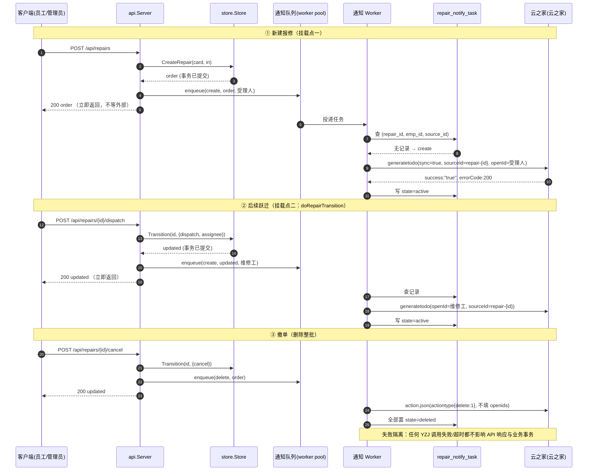
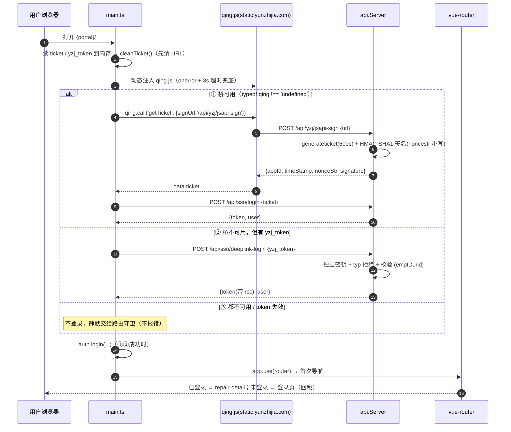

# 云之家（云之家）待办通知集成方案

> 文档定位：**技术集成设计 + 落地方案**。不写代码，但工程师拿着本文即可直接实现。
> 适用仓库：`asset-mgr`（Go 后端 + Vue3/TS/Element Plus 前端，Go module 名 `asset-mgr`）。
> 所有涉及本仓库的论断均给出 `文件:行号` 证据；不确定处一律标 **【需确认】**，不编造。
> 云之家官方接口文档原文见 `C:\tmp\yunzhijia-docs\`（`server-api_im_im-todo.md` / `api_org_index.md` / `api_auth_index.md`）。

---

## 0. 结论摘要（30 秒看懂）

**要做什么**：在维修单状态机的每个关键跃迁上，向「下一个需要行动的人」推送 云之家待办；人处理完后把该待办流转为已读 / 已办；单据终结（撤单 / 驳回）时删除相关待办。待办通知是**外部依赖**，绝不能阻塞或回滚维修单业务事务。

**最小闭环（P0）**：`generatetodo`（创建）+ `action`（流转）+ 本地补偿表 + openId 落库（`employee.open_id`，SSO 回填 + 通讯录增量同步双写）+ 失败隔离（事务外异步投递）+ 深链免登。

**四个最大的风险 / 结论**：

1. **⚠️ 文档自相矛盾（最关键的坑）**：待办流转 `action.json` 的参数表把 `deal`/`read`/`delete` 列为**顶层字段**，但三个 JSON 示例全部使用**嵌套 `actiontype` 对象**，且错误示例明确出现 `param error:actiontype is null.`。→ **必须用嵌套 `actiontype`，顶层平铺写法无效**（详见 §2.2）。
2. **openId 是最大技术缺口**：本仓库当前**没有** openId（`model.User`、`employee` 表、`sys_user` 表都没有，`api/sso.go:29` 拿到的 `u.OpenID` 被直接丢弃）。必须新增 `employee.open_id` 并建立两条回填路径（§6）。
3. **免登结论（不留含糊）**：云之家**网页端**点击待办卡片时**不会**带 `ticket`（`ticket` 是 云之家 **APP** 打开轻应用时才注入的，见 `api_auth_index.md` 第 16 行）。→ 设计**四层降级链**（§5.0）：**⓪ 云之家 APP 注入的 URL `ticket`**（APP 内首选，**已上线**，给完整可写会话）→ **① JS 桥 `qing.call('getTicket')`**（凭据不进 URL，安全性最好）→ **② `?yzj_token=` 一次性 token 深链**（凭据在 URL，必须独立密钥 + `typ` 拒绝 + 绑定 `(empID, repair_id)` + 单会话收窄 + 显式 `Referrer-Policy`）→ **③ 跳登录页回跳**（兜底）。**不得**把凭据放进 URL 当作首选（§5）。
   > **2026-09-21 更新：第 ① 层（JS 桥）已判定在本部署上不可实现** —— 其签名接口要的是 **AppAuth2** 凭据（非 OAuth2 AccessToken），而 AppAuth2 的签发端点在 yzj.example.com 上不存在、规范所在 wiki 对本网 403。取证见 §5.3。**它本也是冗余的**：APP 内第 ⓪ 层已给完整可写会话；网页端则是普通浏览器标签，`qing` 根本不存在。→ 实际生效的是 ⓪/②/③ 三层，**且网页端只有只读的 ②** ⇒ 见 §12-Q16（推荐选项 D）。
4. **`sourceId` 重复创建语义未文档化**：唯一性键是 `openId + appId + sourceId`，所以同一 `sourceId` 给**不同人**是合法的；但**同一人**在同一 `sourceId` 上**重复 create** 的行为官方未说明。→ 用本地 `repair_notify_task` 状态机 + 「先删后建」规避，**绝不依赖 create 报错去重**（§4）。

**已核实的既有资产（可直接复用）**：`integration/yunzhijia/client.go` 已有 app 级 token 缓存与 ticket 解析；`syncer` 已有 `sync_run` / `sync_state` / `external_master_map` 机制；`store/category_guard_test.go` 已有「源码扫描守卫测试」先例。

---

## 1. 背景与范围

### 1.1 业务目标

维修单流程接入云之家（云之家）待办通知：
- 发起维修后能**通知到接收人**；
- 随流程推进**更新待办状态**（已读 / 已办 / 删除）。

### 1.2 挂载点：维修单状态机

- 状态定义：`model/repair.go:14-25`（`pending` 待受理 → `accepted` 已受理 → `dispatched` 已派工 → `repairing` 维修中 → `confirming` 待确认 → `done` 已完工；终态 `rejected` / `cancelled`；P1 预留 `approving` / `scrapping`）。
- 动作码：`model/repair.go:64-76`（`submit/accept/reject/dispatch/take/finish/confirm/return/cancel/approve/scrap`）。
- **状态跃迁唯一入口**：`store.(*Store).Transition`（`store/repair.go:165`）。状态机真值表在 `store/repair.go:137-157`。
- **API 层唯一调用入口**：`api.(*Server).doRepairTransition`（`api/repair.go:276`），签名 `(w, r, o *model.RepairOrder, action string, in store.RepairTransitionInput)`，内部 `s.st.Transition` 后 `writeJSON(w, 200, updated)`（`api/repair.go:279-284`），返回**更新后的完整单据**。
- 新建报修走 `handleCreateRepair`（`api/repair.go:80`）→ `store.CreateRepair`（`store/repair.go:70`），**不经过 `Transition`**（它是 `'' → pending` 的初始化）。

> **结论**：通知挂载点只有两处——① `store.CreateRepair` 之后（新建报修）；② `doRepairTransition` 内、`Transition` 返回之后（所有后续跃迁）。两处都在 **API 层**（不在 store 层，避免 store 依赖外部通知）。

### 1.3 现状盘点（本仓库已有的云之家集成）

| 组件 | 位置 | 说明 |
|---|---|---|
| `Client` | `integration/yunzhijia/client.go:17` | 私有化部署客户端 |
| `NewClient(baseURL, appID, secret, timeout)` | `integration/yunzhijia/client.go:29` | timeout<=0 默认 10s |
| `GetAppToken(ctx)` | `integration/yunzhijia/client.go:52` | 调 `/gateway/oauth2/token/getAccessToken`，**固定缓存 6000s**（`client.go:56`）——⚠️ **忽略响应里的 `expireIn`（剩余秒数），是隐性 bug，见 K11 / §11 P0** |
| `ResolveUser(ctx, ticket)` | `integration/yunzhijia/client.go:99` | 调 `/gateway/ticket/user/acquirecontext`，返回 `User{Username,JobNo,EID,OpenID,UserID}`（`client.go:42-48`，json tag `username/jobNo/eid/openid/userid`） |
| `doJSON` | `integration/yunzhijia/client.go:127` | 统一 POST + 错误包装；**注释明确：错误信息不得携带 token/secret**（`client.go:16`） |
| 装配 | `main.go:74-76` | 仅当 `cfg.Yunzhijia.AppID != "" && Secret != ""` 时注入 |
| `Server.yzj` 字段 | `api/server.go:24` | `SetYunzhijiaClient`（`api/server.go:41`） |
| SSO 免登 | `api/sso.go:12` | `handleSSOLogin`：ticket → JWT |
| 配置 | `config/config.go:57-61`；`config.yaml:60-65` | `yunzhijia.{base_url,app_id,secret}`；环境变量 `YZJ_BASE_URL/YZJ_APP_ID/YZJ_SECRET`（`config/config.go:138-140`） |

> **仓库里完全没有通知/提醒基础设施**（全仓 grep `notif/Notify/通知/提醒/remind` 仅命中无关注释）。本方案是从零开始。

**凭证来源（环境事实，勿误判为缺失）**：`config.yaml:60-65` 与 `deploy/config.yaml:56-61` 里的 `yunzhijia.app_id`/`secret` 是**空串，设计如此**——凭证走 `.env`：
- `start.sh:7-12` 用 `set -a` 加载 `./.env`；
- `asset-mgr.service` 的 `EnvironmentFile=/opt/asset-mgr/.env`；
- `config/config.go:138-140` 的 `overrideIfSet` 用 `YZJ_APP_ID`/`YZJ_SECRET` 覆盖 yaml 空值。
- **已实测**：`.env` 中 `YZJ_APP_ID`/`YZJ_SECRET` **均已配置**（`YZJ_APP_ID` 为 9 位，见 §8「appId 是否同一个」）。

---

## 2. 云之家待办 API 契约（已核实）与关键坑

鉴权：待办接口使用 **`app` 级 AccessToken**（`server-api_im_im-todo.md:7`），与 `client.go` 的 `GetAppToken` 同一套。

### 2.1 三个接口

**① 待办创建** `POST {base}/gateway/newtodo/open/generatetodo.json?accessToken=xxx`，`Content-Type: application/json`

必填：`appId`、`sourceId`、`url`、`content`、`title`、`headImg`（`server-api_im_im-todo.md:25-38`）。
选填：`openId`（顶层，最多 100 人）、`sync`（默认 false，**文档明确建议传 `true`**）、`todoType`（0=通知中心 / 1=待审批）、`tagId`、`itemtitle`、`senderId`、`params[]{openId,url,content}`（params 内 url/content 可覆盖顶层，**传空会被忽略**）。
唯一性键：**`openId + appId + sourceId`** 组合标识 云之家唯一一条待办（`server-api_im_im-todo.md:28`）。`sourceId` 由第三方自设、必须唯一，对应流转接口的 `sourceitemid`。

成功（sync=true）返回 `{"data":{},"success":"true","errorCode":200,"error":"待办创建成功"}`（`server-api_im_im-todo.md:93-99`）。**注意 `success` 是字符串 `"true"` 不是 bool。**

错误码（`server-api_im_im-todo.md:101-151`）：`203` 批量超上限；`501` 部分用户信息错误（`data` 为错误 openId 列表，**其余人继续执行**）；`505` params 内 openId 全错；`404` 获取用户信息失败；`202` 请求过于频繁（`data` 为 `{}`，`success` 甚至是 **bool `false`**）；`0` 参数异常（`data` 里带 `"param error:xxx is null."`）。

`content` 为空则**移动端顶部通知栏不弹通知**（`server-api_im_im-todo.md:34`）。

**② 待办流转** `POST {base}/gateway/newtodo/open/action.json?accessToken=xxx`

字段：`sourcetype`（=appId）、`sourceitemid`（=sourceId）、`actiontype{deal,read,delete}`、`openids`（数组；**不填则改该 sourceitemid 下所有人**）、`sync`（`server-api_im_im-todo.md:176-184`）。
成功文案区分：`待办更新阅读状态成功` / `待办转已办成功` / `待办删除成功`（`server-api_im_im-todo.md:248-270`）。
错误码：`1` 参数异常（`actiontype is null.` / `sourceitemid is null.` / `sourcetype is null.` / `openids is null.`）；`502` 有成员待办更新失败（`data` 为 openId 列表，其余继续）；`404` 获取用户信息失败。

**③ 待办状态查询** `POST {base}/gateway/newtodo/open/checkcreatetodo.json?accessToken=xxx`

字段：`sourcetype`、`sourceitemid`、`openId`（`server-api_im_im-todo.md:345-349`）。
返回 `data.{check,dealCount,undelCount}`；语义（`server-api_im_im-todo.md:388-394`）：`0/0`=单据不存在；`0/1`=待处理；`1/0`=已生成且已办。
用于 `sync=false` 异步模式下的**补偿确认**。

**④（P2，本次不做）待办批量快捷审批**：创建时传 `passUrl`，需应用被后台勾选为「审批类」并拿到 `signKey`；云之家会 POST 到 `passUrl`，报文 `{param:{eid,sourceType,openId,sourceIds[]}, sign}`，`sign` = 对 `[openId, sourceType, ...sourceIds]` **排序后 `&` 连接**再做 **HMAC-SHA1** 后 Base64（`server-api_im_im-todo.md:506-530`）。业务方返回 `data.successIds`，云之家自动把这些待办转已办。

### 2.2 ⚠️ 文档自相矛盾 / 易踩坑清单（单独强调）

| # | 坑 | 证据 | 正确做法 |
|---|---|---|---|
| **K1** | **流转接口参数结构自相矛盾**：参数表列顶层 `deal`/`read`/`delete`，但 3 个示例全用嵌套 `actiontype`，且错误示例出现 `actiontype is null.` | 参数表 `server-api_im_im-todo.md:176-184` vs 示例 `:190-233` vs 错误 `:272-278` | **必须用嵌套 `actiontype` 对象**，如 `{"actiontype":{"read":1,"deal":1}}`；顶层平铺写法无效 |
| **K2** | `success` 字段类型不一致（**已实测**）：认证接口 `/gateway/oauth2/token/getAccessToken` 返回 `success = true`（**bool**）；待办接口 `/gateway/newtodo/open/checkcreatetodo.json` 返回 `success = "true"`（**str**）。同平台不同接口类型确实不一致 | 实测（团队生产凭证探针）+ 文档 `server-api_im_im-todo.md:96`（字符串）vs `:148`（bool） | Go 侧**必须**用 `json.RawMessage` 或自定义 `flexBool` 解析，**不要**直接 `bool`/`string` |
| **K3** | `501` 是**部分成功**：`success=false` 但其余人的待办**已创建** | `:109-117` | 按 `data` 里的错误 openId 列表逐人处理，不能整体判失败重试（会重复创建） |
| **K4** | `202` 频率限制返回 `data:{}`，无法从 `data` 判断哪些成功 | `:145-151` | 视为可重试错误，退避后重试；重试前用 `checkcreatetodo` 确认是否已建成 |
| **K5** | `url` 协议必须与用户登录 云之家门户时的协议**一致**，否则网页端卡片点击跳转报错 | `:156-160` | 配置 `portal_base_url`，强制与门户协议一致（§5） |
| **K6** | `content` 为空则移动端顶部通知栏**不弹通知** | `:34` | `content` 必须非空 |
| **K7** | `params[].url`/`params[].content` **传空值会被忽略**（不会覆盖成空） | `:52-53` | 若想按人定制文案，只在 params 里给**非空**值 |
| **K8** | 唯一性键含 openId：**同一 sourceId 给不同人合法**，但**同一人重复 create 行为未文档化** | `:28` | 用本地状态机 + 「先删后建」规避（§4），不依赖 create 报错去重 |
| **K9** | 通讯录 `getallpersons` 是**增量事件接口**，同一 openId 可能多次出现，返回条数不足 count 才是分页结束 | `api_org_index.md:79-81` | 以**后出现的覆盖**已有记录；用返回的 `data.time` 作下次游标 |
| **K10** | `getallpersons` 的 `Content-Type` 是 **`application/x-www-form-urlencoded`**，不是 JSON | `api_org_index.md:13` | 不能复用 `doJSON`（它写死 JSON，`client.go:136`），需新增表单编码方法 |
| **K11** | **`expireIn` 是「剩余秒数」不是「总时长」**（**已实测**：同一接口连续两次 `expireIn = 7200 → 7161`，**递减**）。token 是**服务端共享**的：任何一方先取过（另一实例 / 运维调试 / 探针），我们拿到的 `expireIn` 可能只剩几十秒 | 实测 + 文档 `server-api_auth_oauth.md:42`「有效期内多次获取均返回同一 token」 | **缓存时长 = `expireIn - 安全余量(300s)`；`expireIn <= 余量` 时不缓存、直接用**。现有 `client.go:52-66` **从首次获取起固定缓存 6000s、完全忽略 `expireIn`**（`:83` 解析后丢弃）→ 是**隐性 bug**，见 §11 P0 |
| **K12** | `refreshToken` 被静默丢弃（**已实测**：响应 `data` 键 = `accessToken/expireIn/refreshToken`，refreshToken 长 32）。文档定义了 `POST /gateway/oauth2/token/refreshToken`（`server-api_auth_oauth.md:146-199`，app 级只需 `appId+refreshToken+timestamp+scope`，**不必传 `secret`**） | 实测 + `server-api_auth_oauth.md:146-199`；现有 `client.go:80-88` 匿名结构体只声明 `AccessToken`/`ExpireIn` | **本期不实现刷新**（仅做 K11 的动态 TTL 缓存）。理由：secret 已在服务端、refreshToken 的「少传一次 secret」收益有限，而引入刷新分支会增加状态与失败路径；如后续需要，再按文档补 `RefreshToken(ctx)`。**不留空、不静默丢弃**（至少注释说明有意不用） |

---

## 3. 触发矩阵（技术视角）

### 3.1 收件人解析（三个来源）

- **报修人**：`order.ReporterEmpID`（`model/repair.go:149`）。
- **维修工**（内部）：`order.AssigneeEmpID`（`model/repair.go:161`，由派工时 `handleDispatchRepair` 写入，`api/repair.go:377-383`）。
- **受理人**：本系统无「受理人」字段，受理 / 驳回 / 派工 / 取消的权限位是 `PermRepairDispatch`（`model/model.go:353`），当前只有 `asset_manager` 与 `admin` 拥有（`model/model.go:364-375`、`api/server.go:133-135`）。→ 收件人取 `SELECT employee_id FROM sys_user WHERE role='asset_manager' AND enabled=1 AND employee_id>0`（`sys_user` 表见 `store/mysql.go:304-316`）。**【需确认】** 是否固定为某几个人 / 某个群（见 §12-Q7）。

### 3.2 触发矩阵

> 约定：`sourceId = "repair-" + strconv.FormatInt(order.ID, 10)`（稳定，详见 §4）。
> 收件人 openId 由 `employee.open_id` 解析；**查不到 openId 则跳过该人并记日志**（不报错）。
> **`todoType` 统一为 `0`（通知中心）**：P0 **全部**用 `todoType=0`。理由见下方「设计取舍」。**不要**出现 `todoType=1`（待审批）。

| # | 跃迁（动作） | from → to | 通知对象 | empID 来源 | 待办操作 | 备注 |
|---|---|---|---|---|---|---|
| 1 | **submit 新建报修** | `'' → pending` | 受理人（可多人） | `sys_user.employee_id`（role=asset_manager） | **create**（`todoType=0`） | 挂载点：`handleCreateRepair`（`api/repair.go:141`）之后 |
| 2 | **accept 受理** | `pending → accepted` | 报修人 | `ReporterEmpID` | 受理人待办 **流转 `{read:1, deal:1}`**；报修人 **create**「已受理」 | 挂载点：`doRepairTransition`（`api/repair.go:316`） |
| 3 | **reject 驳回** | `pending → rejected` | 报修人 | `ReporterEmpID` | 受理人待办 **流转 `{read:1, deal:1}`**；报修人 **create**「已驳回」 | `api/repair.go:334` |
| 4 | **dispatch 派工** | `accepted → dispatched` | 维修工（内部） | `AssigneeEmpID` | **create**（`todoType=0`） | `api/repair.go:377`；`VendorID>0`（外部维保）时**跳过**（无 openId） |
| 5 | **take 接单** | `dispatched → repairing` | 报修人（信息性，可选） | `ReporterEmpID` | 维修工待办 **流转 `{read:1, deal:1}`** | `api/repair.go:396` |
| 6 | **finish 报完工** | `repairing → confirming` | 报修人 | `ReporterEmpID` | 维修工待办 **流转 `{read:1, deal:1}`**；报修人 **create**「待确认」 | `api/repair.go:419` |
| 7 | **confirm 确认完工** | `confirming → done` | 维修工（信息性，可选） | `AssigneeEmpID` | 报修人待办 **流转 `{read:1, deal:1}`**；维修工 **create/流转**「已完工」 | `api/repair.go:435` |
| 8 | **return 退回** | `confirming → repairing` | 维修工 | `AssigneeEmpID` | 报修人待办 **流转 `{deal:1}`**；维修工待办 **重新激活**（见 §4 幂等） | `api/repair.go:458` |
| 9 | **cancel 撤单** | `pending/accepted/dispatched → cancelled` | 相关人（受理人 / 维修工 / 报修人） | 各自 | **delete**（`actiontype{delete:1}`，不填 `openids` → 删该 sourceId 下**所有人**） | `api/repair.go:482` |
| 10 | （P1）approve / scrap | — | — | — | 本次不实现 | `model/repair.go:17,24` |

**设计取舍**：
- **`todoType` 统一为 `0`（通知中心）**（**采纳方案 A**）。文档的准入标准把「要行动」的（受理/接单）与「只知悉」的（结果通知）分开（`server-api_im_im-todo.md:399-405`），但当前**只有一个全局配置**表达不了这种区分；且 P0 **不做快捷审批**（`passUrl`），若把受理/接单推进【待审批】tab 却没有批量审批能力，反而是坏体验。→ **统一 `todoType=0`**，避免「应用是通知类却发待审批」的未定义行为。
  - 备选方案 B（按用途分两个配置）需先确认「**同一应用能否混发两种 `todoType`**」——未确认前不采用。
- **只给「下一个需要行动的人」建待办**（受理人 / 维修工 / 报修人轮转），第三人称的纯信息性通知（如 #5、#7 的报修人 / 维修工）标为**可选**，P0 可先不做，避免「同一人同一单多次 create」的复杂度（§4）。
- #9 撤单优先用「不填 openids 删整批」的写法（`server-api_im_im-todo.md:183`），一条调用覆盖该单全部人。

#### ⚠️ 本矩阵的**已知错误**（以 `docs/维修待办通知-产品定义.md` 为准）

实施时逐行对照产品定义 §2.2/§2.3 发现**本表有 3 处错**，其中两处会导致**真实功能漏洞**（不是文档措辞问题）。**改实现时按产品定义，不按本表**：

| 行 | 本表原文 | **错在哪** | 产品定义依据 |
|---|---|---|---|
| #2 `accept` | 受理人待办**流转 `{read:1,deal:1}`** | ❌ **漏洞**：受理人受理后下一步是**派工**，任务未结束。标已办 + #4 不动受理人 ⇒ **`accepted` 期间无人持有活跃待办，派工提醒彻底消失，单子会静默烂住** | §2.3 事件 13：**不标已办**、不重复发 |
| #4 `dispatch` | 仅给维修工 **create** | ❌ 缺「**把管理员那条标已办**」——与 #2 是一对，缺了它就没人关掉管理员那条待办 | §2.2 行 3 / **AC-2** |
| #5 `take` | 维修工待办**流转 `{read:1,deal:1}`** | ❌ **漏洞**：标已办 = 「接单即完结」，**维修工在维修期间没有任何待办**，忘了报完工也没人提醒。关闭点应是 `finish` | §2.3 事件 14：**只标已读**（`{read:1}`），不新建 |
| #7 `confirm` | 仅报修人待办**流转** | ❌ 缺「被指派维修工 + 全体资产管理员**全部标已办**」（结案） | §2.2 行 7 / **AC-5** |

**另外两处与产品定义不一致（当前有意维持本表，但必须知道）**：

- **#2 报修人那条「已受理」**：本表列为常规 create，产品定义**行 2 标 P1**（纯进展告知）。→ 实现挂在配置项 `yunzhijia.informational_enabled` 下（默认 `false`；**本项目 2026-09-23 已设为 `true`**）。
  打开后这三处（#2/#5/#7）的语义是「**新建已读待办**」（`ensureReadOp`：create 后紧跟 `action{read:1}`；
  因 `generatetodo` 的 `params` 只有 `openId`/`url`/`content`、**没有 `read`** 字段，只能两步），
  即产品定义 Q2 的「推，但置『已读』不打扰」。
  **流程中心通道下这三处不产生**（该通道无「待办置已读」能力，只有 `todo/done` 与 `carboncopy/read`；
  为一条告知创建流程节点不划算）——见 `docs/云之家流程中心集成方案.md` §11 第 4 项。
- **#9 `cancel` 用 delete-all**：本表的理由是**技术便利**（「一条调用覆盖全部人」，见上方取舍），但产品定义把 `cancel` 拆成**两行**：
  - 行 10 报修人撤单 → 管理员**标已办**；
  - 行 11 管理员取消（`accepted`/`dispatched`）→ **报修人刷新 `content`**「你的报修已被管理员取消」+ 维修工标已办。
  → **行 11 是 P0，而 delete-all 做不到它**：删掉全部待办等于**报修人永远不知道自己的报修被管理员取消了**。
  → **已知缺口，暂未实现**：区分行 10 / 行 11 需要**跃迁前的状态**，而 `planFor(o, action, remark)` 拿不到它。**待产品决策**（见 §12 追加项）。

---

## 4. `sourceId` 设计与幂等策略

### 4.1 唯一性分析

唯一性键 = **`openId + appId + sourceId`**（`server-api_im_im-todo.md:28`）。因此：

- **同一 `sourceId` 给不同人合法**：key 含 openId，不同人的待办互相独立、可各自流转。→ 一个维修单用**一个** `sourceId` 通知多人是允许的。
- **同一 `openId` + 同一 `sourceId` 重复 create：行为未文档化**。三种可能（覆盖更新 / 新增重复 / 报错）官方都没写。**不能假设**。

### 4.2 推荐 `sourceId`

**`sourceId = "repair-" + order.ID`**（如 `repair-123`），理由：
1. 稳定、可读、可反查（`sourceitemid` 直接映射回 `repair_order.id`）。
2. 撤单时**不填 `openids`** 一条调用即可清掉该单全部人的待办（`server-api_im_im-todo.md:183`）。
3. 与团队既有倾向一致。

> **备选（若 §12-Q9 确认「重复 create 会新增重复」且「delete+create 有副作用」）**：改用**每轮唯一 sourceId**，如 `repair-{id}-{purpose}-{seq}`（`purpose ∈ {intake,dispatch,confirm,return}`，`seq` 每次重新通知自增）。每轮 create 落在全新 sourceId 上，从根上消除重复创建歧义；代价是撤单需按 `repair_notify_task` 里记录的多个 sourceId 逐个删除。

### 4.3 幂等策略（P0 落地）

**核心：本地状态机做唯一真相，绝不依赖 create 报错去重。**

新增本地表 `repair_notify_task`（见 §6.5 / 附录 DDL）记录**每人每单每 sourceId** 的待办状态：

```
状态机：
  (无记录)                       --create-->  pending/active
  active + 本次是「同一待办推进」   --流转-->   dealt
  active/dealt + 本次要「重新激活」 --先删后建--> active
  active/dealt + 撤单              --流转-->   deleted
  任何操作失败                      -->        failed（记 last_error，等待重试）
```

判定逻辑（worker 消费任务时）：
1. 查 `repair_notify_task WHERE repair_id=? AND emp_id=? AND source_id=?`：
   - **无记录** → `create`；成功后写 `state=active`。
   - **有记录且 active**，且本次语义是「推进该人当前待办」（如受理人受理了自己那条）→ `actiontype{read:1, deal:1}`（或 `read:1`）。
   - **有记录且 active/dealt**，且本次语义是「重新通知同一个人」（如 #8 退回后维修工需再次处理）→ **先 `actiontype{delete:1}`（openids=[该人]）再 `create`**。删不存在的待办应无害（幂等）。
2. 每次外部调用后更新 `state` / `attempts` / `last_error`。

**为什么不能依赖 create 报错去重**（`server-api_im_im-todo.md` 证据）：
- `501` 是**部分成功**（`:109-117`）：报错不代表全部失败，也不代表重复；
- `202` 频率限制（`:145-151`）：报错与「是否已存在」无关；
- `0` 参数异常（`:129-135`）：只覆盖缺参，不覆盖重复；
- 成功文案只有「待办创建成功」（`:98`），**不区分**是新建还是更新；
- `sync=false`（默认异步，`:30`）下 create **根本不会**因重复而报错。

> **优化（待确认后启用）**：若 §12-Q9 确认「同 openId+sourceId 重复 create 为覆盖更新」，则可省去「先删」，直接 create 即幂等。

---

## 5. `url` 深链与免登链路（重点结论）

### 5.0 四层降级链总览（**JS 桥已判定不可用；实际生效 ⓪/②/③**）

用户点击 云之家待办卡片跳进 FAMS 时是**未登录状态**，需要一条免登链路。设计为**四层降级**，逐层尝试、任一层成功即止：

| 层 | 路径 | 触发条件 | 凭据是否进 URL | 安全性 | 会话权限 |
|---|---|---|---|---|---|
| **⓪** | 云之家 APP 注入的 URL `ticket` → `POST /api/sso/login` | 云之家 **APP** 内打开（客户端自动把 `ticket` 附加到跳转 url） | 是（由**客户端**注入，非我方放置） | 中 | **完整可写** |
| **①（原定首选，❌ 已判定不可用）** | JS 桥 `qing.call('getTicket')` → `POST /api/sso/login` | 页面运行在 云之家客户端内且 `typeof qing !== 'undefined'` | 否 | 最好 | 完整可写 |
| **②（兜底）** | `?yzj_token=xxx` 一次性 token → `POST /api/sso/deeplink-login` | ⓪/① 不可用（**网页端门户即此情形**） | 是（token 在 URL 里） | 中 | **仅只读这一张单** |
| **③（最终兜底）** | `#/repairs/{id}` + 登录后回跳 | 上面都不可用 / 配置缺失 / token 过期失效 | 否 | 差但功能可用 | 完整可写 |

> **实现顺序**：⓪ → ① → ② → ③。第 ⓪ 层排在 ① 之前（§5.4），因为 APP 注入的 `ticket` 不需加载外部脚本、更可靠，且是**当前已上线**的行为。

> **⚠️ 2026-09-21 状态更新**：**第 ① 层（JS 桥）已判定在本部署上不可实现** —— 其签名接口 `/authorization/jsapi/generateticket` 要的是 **AppAuth2** 凭据（不是 OAuth2 AccessToken），而 AppAuth2 的签发端点在 yzj.example.com 上不存在、规范所在 wiki 对本网 IP 403。完整取证见 §5.3。**它本也冗余**：APP 内第 ⓪ 层已给完整可写会话；网页端是普通浏览器标签，`qing` 根本不存在。
>
> **→ 实际生效的是 ⓪/②/③。其中网页端用户只有只读的 ②**（网页端不注入 `ticket`，见 `api_auth_index.md:16`），即「看得到、办不了事」。**这是 Q16 必须拍板的原因**，推荐选项 D（只读时给「登录后处理」入口）。

> **为什么原本把 JS 桥列为首选（决策依据）**：第 ② 层把一枚**等价于密码的 bearer 凭据放进 URL**，而该 URL 会被**存在云之家（第三方）的待办系统**里、出现在云之家侧日志/客户端缓存、被用户截图或转发时带出。第 ① 层**根本不需要把凭据放进 URL**，安全性严格优于第 ② 层。这也是为什么第 ② 层必须做 §5.4 那一整套加固。

### 5.1 深链路径（已核实真实 route）

前端路由文件 `web/src/router/index.ts`：
- 使用 **hash history**：`createWebHashHistory()`（`router/index.ts:34`）。
- 维修单详情路由：`{ path: "repairs/:id", name: "repair-detail", ... }`（`router/index.ts:24`），父路由 `path: "/"`（`router/index.ts:7`）。
- 登录守卫：无 token 一律跳 `login`（`router/index.ts:40-42`）。

→ **详情页深链为 `{portal_base_url}/#/repairs/{id}`**（hash 形式，勿写成 `/repairs/{id}` 路径形式）。

### 5.2 `url` 协议要求（K5）

`url` 必须含协议全路径，且**与用户登录 云之家门户时的协议一致**（`server-api_im_im-todo.md:156-160`）。仓库已有 HTTPS 监听（`main.go:99-111`，`config.yaml:4` `tls_addr: ":8443"`），免登跳转本就要求走 HTTPS（`main.go:98` 注释）。

→ 新增配置 `yunzhijia.portal_base_url`，**必须显式配置**（含协议、对外可达的域名/端口）。

**已确认（2026-09-21）**：生产对外地址 = **`https://fams.example.com:8448`**。
- 深链形如 `https://fams.example.com:8448/#/repairs/{id}`（hash 路由，勿写成路径形式）。
- 已写入本地 `config.yaml`（该文件在 `.gitignore` 内）。

> ⚠️ **同一地址上的证书仍未替换，是端到端联调的唯一硬阻塞**：
> - DNS 已生效：`fams.example.com` → `183.6.48.202`；
> - 但 TLS 证书**仍是原来的自签证书** `CN=10.0.0.180`（`O=AssetLedger`，有效期至 2036），
>   SAN 只有 `10.0.0.180 / 127.0.0.1 / localhost` —— **不含 `fams.example.com`**；
> - 实测不带 `-k` 直连：`curl: (60) SEC_E_UNTRUSTED_ROOT`（证书链由不受信任的颁发机构颁发）；
>   带 `-k` 才 200。
> - → **用户点待办卡片会先撞浏览器证书警告**（「连接不安全」），免登链路无法端到端验证。
> - **修法**：换一张覆盖 `fams.example.com` 的受信证书。因为 HTTPS 用的是 **8448**（不是 443），
>   HTTP-01 / TLS-ALPN-01 挑战都需要 80/443，**只能用 DNS-01**（在 `example.com` 的 DNS 加一条
>   `_acme-challenge.fams.example.com` TXT 记录）签发 Let's Encrypt 证书，然后替换
>   `cert/server.crt` / `cert/server.key` 并重启。
> - 注：仓库 `cert/server.crt` 就是上面这张自签证书，**必须一并替换**（否则重启后仍是旧的）。

**另一处部署漂移（需注意）**：公网 8448 上跑的前端是**旧构建**（`index-Bp7STPig.js`），
而本地 `web/dist` 已是 `index-DpRq7LL0.js`（含三层免登链）。→ **公网尚未部署本次前端改动**。

### 5.3 第 1 层：JS 桥免登 —— ❌ **已判定在本部署上不可实现**（保留本节作为取证记录）

**证据**：`client-api_lightapp_bridge-auth.md:66-192`（本地原文 `C:\tmp\yunzhijia-docs\client-api_lightapp_bridge-auth.md`）。

**完整链路**（⚠️ **以下为原设计记录，已判定不可实现，请勿照此实现** —— 保留是为了让后来者看清「当初打算怎么做」以及**在哪一步断掉**）：

1. **引入 JS 桥**。文档明确警告：**不可下载到本地，必须用在线版**（`client-api/index.md`，团队已核实；本次未抓到该页本地副本，以团队核实的结论为准）：
   ```html
   <script src="https://static.yunzhijia.com/public/js/qing/latest/qing.js"></script>
   ```
   > **本方案的实现建议**：**不要**把它硬编码进 `web/index.html`，改为在 `main.ts` 里**动态注入**（见 §5.6），以便「先清 URL、再加载外部脚本」，彻底消除 token 随 Referer 外泄的可能。

2. **前端调用**（`client-api_lightapp_bridge-auth.md:74-87`）：
   ```js
   qing.call('getTicket', {
     signUrl: '/api/yzj/jsapi-sign',   // 我方新增的签名接口
     signMethod: 'post',
     success (e) { /* e.data.ticket → 送 /api/sso/login */ },
     error (err)  { /* 降级到第 2 层 */ }
   })
   ```

3. **客户端把当前页面 url 作为 `url` 参数 POST 到 `signUrl`**（`client-api_lightapp_bridge-auth.md:93` 原文：「这个接口会接收到一个名为url参数（post）」）。

4. **后端签名接口 `/api/yzj/jsapi-sign`（新增）两步**（`client-api_lightapp_bridge-auth.md:132-192`）：
   - a. 获取 jsapiticket：`POST /authorization/jsapi/generateticket`，body `accesstoken=xxxxx`（**表单编码**），返回 `data.{jsapiticket, expires_in:600}`（`:132-147`）。
     **注意：`expires_in` 仅 600 秒**，与 `GetAppToken` 的 6000s 缓存（`integration/yunzhijia/client.go:56`）**是两回事**——`jsapiticket` 要**单独按 600s 缓存**，不要复用 app token 的缓存。
   - b. 生成签名（`:149-192`）：
     ```
     signature = Base64( HMAC-SHA1( baseline, jsapiticket ) )
     baseline  = "noncestr=" + nonceStr + "&timestamp=" + timestamp + "&url=" + url
     ```
   - c. 返回 `{appId, timeStamp, nonceStr, signature}`（`:97-107`）。

5. 客户端回传 `data.ticket` → 前端调**现有的** `POST /api/sso/login`（`web/src/main.ts:51`）→ 后端 `handleSSOLogin`（`api/sso.go:12`）用 `ResolveUser` 换 JWT。**这一步完全复用现有链路，无需改动。**

#### ⚠️ 陷阱 1：`noncestr`（全小写）vs `nonceStr`（驼峰）

- **baseline 拼接**用的是全小写 **`noncestr`**（`client-api_lightapp_bridge-auth.md:180`）；
- **返回给客户端的 JSON 键**是驼峰 **`nonceStr`**（`:103`）。

**照抄必错**：签名用 `noncestr=` 拼、返回字段名写 `nonceStr`，两者不可混用。这是最容易翻车的点。

#### ⚠️ 陷阱 2：hash 路由下的 `url` 形态（**必须实测**）

签名按 `url` 签，而我们是 **hash 路由**（`web/src/router/index.ts:34` `createWebHashHistory()`），深链形如 `https://host/#/repairs/123`。**客户端传给 `signUrl` 的 `url` 含不含 `#...` 片段，文档没写。** 由于 HMAC 签名是**单值**（一次只能对一个 baseline 出一个签名），无法「两种都返回」，因此落地为：

- 默认**按收到的 `url` 原样签名**（文档语义：客户端送来什么就签什么）；
- 提供配置开关 `yunzhijia.jsapi_sign_strip_hash`（默认 `false`）：若首次联调发现客户端校验的是**不含 hash** 的形态，置为 `true`，签名前先剥掉 `#` 及其后片段；
- **列为必测项**（§5.8）：用真实客户端分别验证含 hash / 不含 hash 两种形态，确定开关取值。

#### ⚠️ 实施记录：第 1 层**被云之家侧卡住 → 已定性为不可实现**（2026-09-21 实测）

**实测结论（生产凭证探针，零业务副作用）**：

| 请求 | HTTP | 业务返回 | 判断 |
|---|---|---|---|
| `POST /authorization/jsapi/generateticket` | 200 | `{"success":false,"errorCode":501,"error":"accesstoken验证失败"}` | **路由存在**（非「URI 不存在」），但**凭证被拒** |
| `POST /gateway/authorization/jsapi/generateticket` | 200 | `{"errorCode":10000404,"error":"请求的URI地址不存在"}` | ❌ `/gateway/` 前缀**是错的** |
| `GET /authorization/jsapi/generateticket` | 405 | — | 仅支持 POST |
| `POST /jsapi/generateticket` | 404 | — | 不存在 |

→ **真实路径就是文档原文的 `/authorization/jsapi/generateticket`（不带 `/gateway/`）**，已按实测实现。

**501 的归因（已定性，2026-09-21 二次取证）**：`api_index.md` 对这个端点有一句**专门的警告**（原文）：

> 请注意：[JS生成ticket的方法](/client-api/lightapp/bridge-auth?id=通过js桥获取ticket)中用到的**签名接口会用到一个 `access_token` 参数，与此处讨论的 AccessToken 容易混淆，一定要注意区分**。

**这句话本身就是答案：该签名接口要的 `access_token` 不是 OAuth2 的 AccessToken。** 已用三轮探针把它钉死。

**取证一：路由确实存在（排除「接口没部署」）**

| 请求 | HTTP | 返回 | 判读 |
|---|---|---|---|
| `POST /authorization/jsapi/generateticket` | 200 | `{"success":false,"errorCode":501,"error":"accesstoken验证失败"}` | **业务级拒绝**（不是网关级「URI 不存在」） |
| `GET /authorization/jsapi/generateticket` | **405** | `Request method 'GET' not supported` | **铁证**：只有**已注册该路径**的框架才会回 405 |
| `POST /authorization/jsapi/zz-nonexistent-xyz`（对照） | 404 | openresty 404 页 | 兄弟路径无路由 |
| `POST /authorization/`、`/authorization` | 404 | openresty 404 页 | 父路径无路由 |
| `POST /gateway/authorization/jsapi/generateticket` | 200 | `10000404 请求的URI地址不存在` | 网关自述无此路由，与真接口的 501 **是两种签名** |

→ 真接口**存在且在工作**，它确实在校验一个 `accesstoken`；501 不是「接口不在」。

**取证二：任何 OAuth2 token 形态都被同一句话拒绝（排除「参数写法不对」）**

| 传入 | 结果 |
|---|---|
| form `accesstoken=<app 级 token>`（len=32, expireIn≈7159） | 501 accesstoken验证失败 |
| json `accesstoken=<app 级 token>` | 同上 |
| form `accesstoken=<appId>` / `<secret>` / `<appId:secret>` | 同上 |
| form `accessToken=<token>` / `token=<token>` | 同上 |
| **空 body**（不带任何参数） | **同上** |
| header `Authorization: Bearer <token>` / `Authorization: <token>` / `access_token` / `accessToken` / `X-Access-Token` / `accesstoken` / `Cookie: yzj_access_token=` | 同上 |
| `.json` 后缀、`+eid`、`+appId` | 同上 |

→ **连空 body 都返回同一句「accesstoken验证失败」**，说明它根本没有在解析我们的参数名/位置。**换任何 token、任何写法都不会通。**

**取证三：AppAuth2 这条腿在本部署上不存在**

- 文档 `:128`「第一步：获取应用授权」指向**另一个协议**：`open.yunzhijia.com/wiki/…appauth2:appAuth2授权协议`，**不是** OAuth2。
- yzj.example.com 上**没有任何 AppAuth2 发 token 的路由**：`/authorization/appauth2/token`、`/authorization/appauth2/getAccessToken`、`/authorization/token/getAccessToken`、`/authorization/jsapi/getticket`、`/authorization/jsapi/getjsapiticket` —— **全部 404 openresty**。
- 本网读不到 AppAuth2 规范：`open.yunzhijia.com` 根路径 200 可达，但其 wiki（`/wiki/doku.php`，**连根路径**）对本网 IP 一律 **403**「请求不合法或请求过于频繁…您的IP地址为: 211.154.233.2」。
- yzj.example.com 现行文档站**整体不含 appauth2 任何内容**（`opendocs/js/docs.js` 无匹配；本地 12 页抓取件亦无）。

#### ✅ 结论：第 1 层（JS 桥）在本部署上**不可实现**，且这不是配置问题

`generateticket` 要的是 **AppAuth2 协议**下发的凭据；该协议的**签发端点不存在于 yzj.example.com**、**规范也只存在于对本网封锁的旧 wiki**。因此：

- **不要再等 Q12、不要再试 token 形态**——这是协议体系不匹配，穷举参数没有出路；
- **`/api/yzj/jsapi-sign` 不实现**（原判断维持并加强）：取票这条腿已证不可通，写路由等于造一个**可证明不可能工作**的东西；
- `integration/yunzhijia/jsapi.go` 的签名部分是**纯本地计算**（baseline + HMAC-SHA1 + Base64），已完成且有单测覆盖。**保留但标注为「当前无调用方」**——它只在「云之家将来愿意为 AppAuth2 单独开凭据」时才有用。

#### 🔁 连带结论：第 1 层**本来就不必要**，真正待决的是 Q16

放弃第 1 层不是「损失一个功能」，因为它在两个真实入口上**本来就用不上**：

| 入口 | 打开方式 | 第 0 层（URL `ticket`） | 第 1 层（JS 桥） |
|---|---|---|---|
| 云之家 **APP** | 客户端内 webview | ✅ 注入 `ticket` → **完整可写会话** | ❌ **冗余**：实现里第 0 层先于第 1 层尝试（§5.4），APP 内根本轮不到桥 |
| 网页端**门户** | 普通浏览器标签 | ❌ 网页端不注入 `ticket`（`api_auth_index.md:16`） | ❌ `typeof qing === 'undefined'`，桥不存在 |

第 1 层唯一可能的用武之地是「网页端门户把待办目标嵌进 **iframe** 且桥可用」——这正是方案里标注为**未验证**的假设 M3。

→ **真正需要拍板的是 Q16**：网页端用户点待办进来，落到**严格只读**的第 2 层，看得见单子但办不了事（`deeplinkScopeAllows` 对任何非 GET 方法直接 `return false`，`api/deeplink.go:236`）。四个选项与推荐见 §12-Q16。

#### ⚠️ 未决冲突：baseline 的分隔符 `&`（**必须真机确认**）

**同一份文档内部自相矛盾**：

| 出处 | baseline 形态 |
|---|---|
| 本文档 §5.3 规范（**已实现**） | `noncestr=..&timestamp=..&url=..`（**带 `&`**） |
| 文档参考实现 `client-api_lightapp_bridge-auth.md:180` | `"noncestr="+noncestr+"timestamp="+timestamp+"url="+url`（**不带 `&`**） |

两者对同一向量产生**不同签名**：带 `&` = `tDBu2p3vU9uIOXeGOm7KblFU+2Q=`；不带 `&` = `loo2YRPwCbkR/CI6rEJto+TZRIY=`（两个向量都已写进 `jsapi_test.go` / `jsapi.go` 注释钉住）。

**当前决定：维持带 `&`**。理由是该 Java 片段**本身至少还有两处明显错误**，不足以推翻「`&` 拼接是这类签名基线惯例」的判断：
1. `:160` 写 `data.put("timestamp", ...)`（**小写**），而 `:102` 的返回契约是**驼峰 `timeStamp`**——同一片段内自相矛盾；
2. `:168` 写 `data.put("jsapiticket", jsapiticket)`——把**签名密钥本身**返回给前端，明显反模式。

→ 若真机联调证明**不带 `&`**，改 `jsapi.go` 的 `jsapiBaseline` **一行**即可，且改完测试会立刻报出签名变化值。

#### ⚠️ 未决项：签名接口的**返回信封与键名**（未实测）

- 返回契约（`:97-107`）写的是**带信封**：`{"success":true,"data":{appId,timeStamp,nonceStr,signature}}`；
- 而 `:112-123` 的「页面直出」示例是把 4 个字段**平铺**传进 `qing.call`。

→ 我们**自建的** `signUrl` 接口该返回哪种形态，**未实测**。实现 `/api/yzj/jsapi-sign` 时必须先定这一点（并考虑同时给出两种形态以容错）。

### 5.4 第 2 层（兜底）：`?yzj_token=` 一次性 token 深链（**已修 5 处安全缺陷**）

> **前提**：第 2 层只在第 1 层（桥）不可用时启用（外部浏览器直接打开）。它把凭据放进 URL，是**降级方案**，因此必须做以下加固。**上一版设计有漏洞，本节为修订版。**

**链路**：后端生成待办 `url` 时，为该收件人签发一枚**短用途免登 token**：

```
url = {portal_base_url}/#/repairs/{id}?yzj_token={token}
```

前端读取（query 或 hash query 都读，参照 `web/src/main.ts:23-31` 与 `utils/deeplink.ts:6-14`）→ 调新增接口 `POST /api/sso/deeplink-login`（需加入 `api/auth.go:86` 豁免）→ 换会话 token。

**缺陷 1（严重）：token 混淆 → 免登 token 能当会话 token 直接用。修法（必须）：**
- **独立密钥**：用 `yunzhijia.login_token_secret`（**不复用** `auth.jwt_secret`），与 `api/auth.go:75` 的会话签名密钥**物理隔离**；
- **用途声明**：claims 里加 `typ:"yzj_deeplink"`；
- **中间件显式拒绝**：`Authenticate`（`api/auth.go:84-101`）在 `jwt.ParseWithClaims` 之后**显式拒绝** `typ == "yzj_deeplink"` 的 token（独立密钥已能挡住，但这条是「将来有人统一了密钥」的兜底，必须写）；
- **验证方法**：拿一枚免登 token 直接调 `GET /api/repairs`，**必须返回 401**（写成测试，见 §10）。

**缺陷 2：未绑定单据。修法：**
- 免登 token claims 增加 `rid`（repair_id）；`deeplink-login` 校验 `rid` 存在、且与目标单据一致；
- **会话收窄**：`deeplink-login` 签发的会话 token 带 `rsc`（`repair_scope=rid`）声明，使该会话**只能看这一张单**；
  - **单一收口点**：`api/repair.go:192 loadRepairInScope` 是详情 / 日志 / 附件三个读接口（`handleGetRepair:218` / `handleRepairLogs:226` / `handleRepairAttachments:239`）的公共入口 → 在此校验 `rsc` 与 `o.ID` 一致；
  - `Authenticate`（`api/auth.go:84-101`）对带 `rsc` 的会话：**只放行 `/api/repairs/{id}` 读路由**，其余路径 403；
  - **UX 代价**：经第 2 层进入的用户只能看该单，导航到其它页面会 403 —— 对「点待办看这一单」的场景可接受，用户可正常密码登录获得完整权限。

**缺陷 3：一次性 vs 可重复点击。决策：TTL 内允许多次（不一次性）。**
- **理由**：用户重复点击同一待办很常见（第一次没看清就关掉）；严格一次性会让第二次点击失败，体验差。用**短窗口 + 绑定 `(empID, rid)` + 独立密钥 + typ 拒绝 + 单会话收窄**换取可用性。
- **TTL 取值（关键约束）**：token 在**待办创建时**签发，而用户可能在**数小时后**才点击 —— 所以 TTL 必须覆盖「待办可点击窗口」。**建议默认 24 小时**（可配 `yunzhijia.deeplink_token_ttl`），**越长越方便、泄露窗口越大**；最终取值 **【需确认】**（§12-Q8）。
  - 优化：每次「重新通知」（§4.3 的先删后建）都**重签**新 token，使窗口与「活跃待办」对齐。
- **过期/失效的兜底（硬要求）**：token 无效时**静默降级到第 3 层**（跳登录页 + 回跳），**绝不能让用户看到报错**。

**缺陷 4：Referer 泄漏面（分析 + 必做项）**：
- **已查实**：全仓 `*.go` **零安全响应头**（`Referrer-Policy` / `X-Frame-Options` / `Content-Security-Policy` / `X-Content-Type-Options` 全部零命中）；`web/index.html` 目前**无任何外部资源**（只有 `/src/main.ts`）。
- 浏览器默认策略 `strict-origin-when-cross-origin` → 跨域请求只发 origin，**token 不会随 Referer 漏给外部域**（好消息）；**但这是「靠默认值」，没有显式声明**。
- → **本次必做**：在服务端显式设置 `Referrer-Policy: strict-origin-when-cross-origin`，顺带 `X-Content-Type-Options: nosniff`（低成本加固）。见 §5.7。

**缺陷 5：iframe 可行性是第 1 层的前置条件（脆弱，需钉死）**：
- 当前**没有** `X-Frame-Options` / `CSP frame-ancestors` → 页面**可以**被 云之家门户 iframe 嵌入 → **第 1 层桥路径才有可能成立**。
- **这是有利条件但极脆弱**：将来任何人加上 `X-Frame-Options: DENY` 就会**静默破坏**桥路径（表现为「免登突然要登录」，且不会让任何测试变红）。
- → 写成**显式约束**：注释 + 文档警示（§5.7 / §5.8），**禁止**在未评估影响前添加 `X-Frame-Options: DENY` 或收紧 `frame-ancestors`。

#### 5.4.1 实现记录（已落地，commit `cfd67a6`）

**`url` 的实际形态**（与本节设计一致，但有一处刻意的取舍需要记录）：

```
{portal_base_url}/#/repairs/{id}?yzj_token={token}
```

**取舍：token 放在 `#` 之内，不是 `#` 之前。**
片段（fragment）不会被浏览器发进 HTTP 请求行，因此凭据不进服务端访问日志、也不进 `Referer` ——
这正是 §5.6「凭据早于外部脚本清除」能成立的前提。
前端 `readParam()` 读 `window.location.search` 与 hash query **两处**，所以
`/?yzj_token=...#/repairs/{id}` 这种写法功能上"也能用"，但安全性更差（凭据进请求行）。
两种写法只差一个位置、都看不出报错，**故必须由测试钉住**：
`api/deeplink_integration_test.go` 的 `splitDeepLink()` 断言 `u.RawQuery == ""`。
（反向验证：把 token 挪到 `#` 之前 ⇒ 3 条用例变红。）

**签发与绑定**：
- 签发逻辑抽成包级函数 `mintDeeplinkToken(secret, ttl, empID, repairID)`，`(s *Server) MintDeeplinkToken` 改为薄封装。
  理由：待办 URL 由 `NotifyService`（`api/notify.go`）拼装，而它**不持有 `*Server`**；
  若为它复制一份签发逻辑，两处迟早漂移 —— 尤其是「用哪把密钥」与 `typ` 取值这两个安全要点。
- `NotifyService` 新增 `deeplinkSecret` / `deeplinkTTL`，在 `NewNotifyService` 中取自
  `cfg.Yunzhijia.LoginTokenSecret` / `DeeplinkTokenTTL`（存的是**独立密钥**，不是 `auth.jwt_secret`）。
- **绑定收件人**：`eid` 取 `op.empID`（该条待办的收件人），不是 `repairID`、也不是常量。
  否则 A 收到的待办被转发给 B，B 也能免登进来看这张单。
- **签发失败静默降级为裸链接**：未配置 `login_token_secret`（第 2 层按设计静默禁用）**不记日志**；
  其它失败（`empID`/`repairID` 非法）才记一条。**绝不能**因为第 2 层不可用就让待办发不出去 ——
  降级后第 0 层与第 3 层仍可用。

**收窄校验是两处独立实现（刻意）**：
| 位置 | 依据 | 说明 |
|---|---|---|
| `api/auth.go` `deeplinkScopeAllows` | 解析 **URL 路径字符串**里的 `{id}` | 中间件层，先拦一道 |
| `api/repair.go` `loadRepairInScope` | 比对**实际取到的行**的 `o.ID` | 对象层，再拦一道 |

两处都留是有必要的：一旦将来路由形态变化（别名、大小写、尾斜杠、编码，或新增一条也能取到维修单的路由）
导致两边解析口径出现分歧，只靠路径那层就可能漏；对象级那层**不依赖任何解析**，仍然能挡住。
对象级检查放在 `s.repairScope` **之前**：既省一次可能查库的范围解析，也让拒绝原因更准确。

**已知限制（产品层面，需知悉）**：收窄会话是**只读**的 —— `deeplinkScopeAllows` 对非 GET 一律 false，
而 `accept` / `take` / `confirm` 都是 POST。因此经**第 2 层**进入的收件人**能看这张单、但无法执行待办要求的动作**。
设计上这原本可以接受：APP 内走**第 0 层**（客户端注入 `ticket` → 完整可写会话），第 2 层只是「第 0 层不可用」时的兜底。
**但第 0 层只在云之家 APP 内生效** —— 网页端门户**不注入** `ticket`（`api_auth_index.md:16`），
而第 1 层（JS 桥）**已定性为不可实现**（§5.3：501 是 AppAuth2 协议不匹配）。
→ **网页端用户 100% 落到只读的第 2 层**，「点进去办不了事」是**必然而不是边缘情况**。
→ 这是**产品决策**，已升级为 §12-Q16（推荐选项 D）。

**该限制的两个衍生问题（独立验证发现，已逐条确认代码层面属实）**：

1. **UX 死角：写按钮仍会渲染，但一点就 403。** 详情页的动作按钮（受理 / 接单 / 完工 / 确认 / 派工）
   在收窄会话下**照常渲染**，点击后由 `Authenticate` 返回 403「免登会话仅可查看该维修单」，
   表现为「按钮在、点了报错」。根因已核实：`/api/me`（`api/auth.go:109`）只回 `userFrom(r)` 的
   `model.User`，**不含** `rsc`，所以前端**无从知道**自己是收窄会话。
   修法（若决定修）：`/api/me` 增加一个只读标志（如 `readonly_session: true`），前端据此隐藏/禁用写按钮。
   涉及后端 + 前端 + 重新构建部署，**不在本次范围内**（见 §12-Q16）。
2. **`/uploads/` 静态路由未鉴权**（**既有问题，非本次引入**）：修复附件文件名不可猜（`crypto/rand`），
   故属「靠不可猜性」而非「靠鉴权」。本次不改，登记备查（§12-Q17）。

**验证（`api/deeplink_integration_test.go`，5 条，全绿无 skip）** 与反向验证结果：

| 变异 | 变红的用例 |
|---|---|
| 查询参数 `yzj_token` 改名 | `EmbedsRecipientBoundToken`、`BindsEachRecipientSeparately` |
| `eid` 改成 `repairID` | 同上 2 条 |
| token 挪到 `#` 之前 | 上述 2 条 + `BaseURLTrailingSlash` |
| 对象级收窄条件强制 false | `LoadRepairInScopeRejectsForeignRepair` |
| （还原后） | 全绿 |

`LoadRepairInScopeRejectsForeignRepair` **自己写库造探针单**，而不是「查库里现成的一张」——
后者会在空库上静默 Skip，而被跳过的安全用例等于没有用例。

### 5.5 第 3 层（最终兜底）：登录页回跳
- `url = {portal_base_url}/#/repairs/{id}`（不带任何凭据）。
- 未登录 → 路由守卫跳登录页（`web/src/router/index.ts:40-42`）→ 登录后由 `utils/deeplink.ts` 同款机制回跳到详情页。
- 触发条件：第 1、2 层都不可用 / `portal_base_url` 未配置 / 免登 token 过期失效。
- 这是**牺牲免登体验**的兜底，但保证功能可用、且**零凭据暴露**。

### 5.6 前端集成顺序（`cleanTicket` 必须早于任何外部资源加载）

> **⚠️ 2026-09-21 更新：本节已因「第 1 层作废」而简化（§5.3）。**
> 原设计里 `qing.js` 必须**动态注入**而不能静态写进 `index.html` —— 因为静态引入会让它早于 `main.ts` 加载，使 URL 里的 `yzj_token` 随 Referer 外泄。
> 现在**前端根本不加载 `qing.js`**（第 1 层整段删除）⇒ 那个具体约束消失了。但 **`cleanTicket()` 必须早于任何外部资源加载**这条纪律**保留**：将来一旦引入任何第三方脚本，它会立刻重新变成硬约束。

**关键时序**：`?yzj_token=` 是 URL 里的凭据，必须在**加载任何外部脚本之前**从 URL 剥掉，否则会随 Referer 外泄。

`web/src/main.ts` 启动顺序（**已实现**）：

1. `stashAssetCode()`（`main.ts:70`，保留）；
2. **读取并暂存** `ticket` / `yzj_token`（读 query 与 hash query），随即 `cleanTicket()` **从 URL 剥掉** —— **此时 URL 已无凭据**；
3. ~~动态注入 `qing.js`~~ → ❌ **已删除**（第 1 层作废，§5.3）；
4. ~~第 1 层 JS 桥 `qing.call('getTicket')`~~ → ❌ **已删除**；
5. **第 2 层**：有暂存的 `yzj_token` → `POST /api/sso/deeplink-login`；成功即 `auth.login`（**响应带 `readonly`**，Q16 方案 D）；
6. **第 3 层**：都不行 → 什么都不做，交给路由守卫（`router/index.ts:36-44`）跳登录页（**带 `?redirect=` 回原单**，Q16 方案 D）；
7. `app.use(router)` → `app.mount("#app")`（`main.ts:72-73`）。

**实际降级链**：**⓪** APP 注入 `ticket` → **②** `yzj_token` → **③** 登录页。**第 1 层已删，不再是三层。**

> **移动端 APP 注入的 `ticket`**：第 0 层先用它换会话（成功则得**完整可写会话**）；失败后若 URL 里还有 `yzj_token`，第 2 层会用同一「暂存值」再试。两种来源在前端按「先 `ticket` 后 `yzj_token`」顺序尝试。

#### 实施偏差（**已落地，以代码为准**）

**「无凭据则短路整条链」的守卫保留**：`hasAnyCredential` 为假时直接返回 `false`，**不加载任何外部脚本、不发任何请求**（`web/src/utils/yzj-login.ts`）。

> 这条守卫原本是为了「无 `ticket` 且无 `yzj_token` 时不加载 `qing.js`」。`qing.js` 已随第 1 层删除，但**守卫本身仍然必要**，理由不变：

1. **不回归**：现有已上线行为就是「没 ticket 直接跳登录页」，加守卫等于保持原状；无条件探测反而会改变所有匿名访问的行为。
2. **代价不对称**：免登链必须在 `app.use(router)` **之前** `await` 完成（否则守卫会重写 hash 冲掉深链）。让**每一次**页面加载都多等一次网络往返，而收益只覆盖一个很窄的入口。

> **⚠️ 这一节同时是一份教训记录。** 原设计把「主路径不受影响」列为理由之一，但**实际实现的降级顺序是 ⓪ → ①(桥) → ②(token)**，而网页端门户点待办时**只有 `yzj_token`、没有 `ticket`** ⇒ 主路径**反而成了受害者**：每次都要先跨域拉 `qing.js`、等它超时或等 `window.qing` 判定失败，然后才轮到真正能用的第 2 层。
> **一个已被证伪的机制若留在热路径上，代价不是零，而是「每次都给用户加一次白等」。** 这是本次删除第 1 层（而非注释掉）的直接动因 —— 见 §5.3 与交付物清单里对 `yzj-login.ts` 的要求。

**明确记录的代价**：「用户**手动**在云之家客户端内打开 FAMS，且客户端未注入 `ticket`」这**一种**入口失去桥免登能力，会落到第 3 层登录页（仍可用密码登录）。
→ 若真机实测（M2/M3）证明该入口重要，**删掉 `hasAnyCredential` 守卫即可恢复本文档原设计**（一行改动）。

**另一处顺序说明**：实现把**第 0 层（URL `ticket`）排在第 1 层（JS 桥）之前**。因为 APP 注入的 `ticket` 不需要加载任何外部脚本、更可靠，且这是**当前已上线**的行为——放在桥后面会让每次 APP 打开都先付一次外部脚本的加载成本。

### 5.7 安全响应头（本次必做）

`web/index.html` 无外部资源 → 引入 `qing.js` 后会出现**第一个外部子资源**，因此必须显式声明策略。在服务端统一加（如 `Authenticate` 或新增一层中间件，`api/auth.go:84`）：

```
Referrer-Policy: strict-origin-when-cross-origin
X-Content-Type-Options: nosniff
```

**约束（禁止项）**：**不得**添加 `X-Frame-Options: DENY` 或收紧 `Content-Security-Policy: frame-ancestors`，否则会**静默破坏**第 1 层桥路径（§5.4 缺陷 5）。若确需限制 iframe，必须先用真实门户验证桥路径不受影响。

### 5.8 必须用真实客户端实测的清单（不依赖单测）

| # | 实测项 | 为什么必须实测 | 失败时降级 |
|---|---|---|---|
| ~~M1~~ | ~~客户端传给 `signUrl` 的 `url` 是否含 `#` hash 片段~~ | ❌ **已作废**：第 1 层不可实现（§5.3） | — |
| **M2** | 云之家**网页端**点卡片**是否真的不注入 `ticket`** | 决定第 2 层是否必要 —— **它是 Q16 方案 D 的前提**（若网页端也注入 `ticket`，只读问题就不存在了） | 若注入 ticket，第 2 层可简化、Q16 可撤销 |
| ~~M3~~ | ~~JS 桥在网页端门户（iframe）内是否可用~~ | ❌ **已作废**：即使 iframe 里桥可用，签名接口也拿不到凭据（§5.3） | — |
| ~~M4~~ | ~~`signUrl` 回调是否带完整 URL（含 query）~~ | ❌ **已作废**：同上 | — |
| ~~M5~~ | ~~`qing.js` 能否从 `static.yunzhijia.com` 加载~~ | ❌ **已作废**：前端不再加载 `qing.js` | — |
| ~~M6~~ | ~~`generateticket` 的 `accesstoken` 用 `GetAppToken` 是否可通~~ | ✅ **已定性：不通**。它要的是 **AppAuth2** 凭据，OAuth2 的 app token 一律被拒（§5.3 取证三连） | — |
| ~~M7~~ | ~~`iframe` 嵌入是否被浏览器策略拦截~~ | ❌ **已作废**：第 1 层不可用后不再需要 | — |

> **仅剩 M2 待实测**。其余 6 项都因「第 1 层作废」而失去意义 —— 保留划掉是为了让后来者知道**这些坑已经踩过并定了性**，不要再翻出来重试。

### 5.9 网络可达性（**两个域，必须分开确认**）

- **`yzj.example.com`**：服务端调用（token / 待办 / 通讯录）—— 见 §12-Q4。✅ 开发机实测可达（HTTP 200）；**生产环境需单独确认**（只有 yzj.example.com 能出网）。
- **`static.yunzhijia.com`（CDN，加载 `qing.js`）**：**仅第 1 层（JS 桥）需要，而第 1 层已作废（§5.3）⇒ 本项不再需要。**
  - 实测该域**可达**（HTTP 200，2026-09-21），但**已无意义**：前端不再加载 `qing.js`（见 §12-Q11）。
  - 这一条原本是「客户端侧可达性」问题（与 `yzj.example.com` 是不同的域、不同的确认项）—— 现在整个问题随第 1 层一起消失。

---

## 6. openId 获取与存储

### 6.1 现状（缺口）

- `model.User`（`model/model.go:306-320`）字段：`ID/Username/RealName/Role/EmployeeID/EmployeeName/DeptID/DeptName/Enabled`，**无 openId**。
- `employee` 表（`store/mysql.go:229-241`）列：`id, emp_no, name, dept_id, company_id, phone, active, source, created_at`，**无 open_id**。
- `sys_user` 表（`store/mysql.go:304-316`）列：`id, username, password_hash, real_name, role, employee_id, dept_id, enabled, created_at`，**无 open_id**。
- SSO 免登拿到的 `u.OpenID`（`api/sso.go:29`）**被直接丢弃**。

### 6.2 落点决策：`employee.open_id`（**采纳团队倾向**）

**通知对象是「员工」**（`RepairOrder.AssigneeEmpID` / `ReporterEmpID` / 受理人的 `employee_id`），且**大量员工根本没有本系统账号**（`sys_user` 里没有对应行）。→ openId 落到 **`employee.open_id`**，而非 `sys_user`。

### 6.3 列定义（DDL）

```sql
ALTER TABLE employee ADD COLUMN open_id VARCHAR(64) NOT NULL DEFAULT '';
ALTER TABLE employee ADD KEY idx_emp_open_id (open_id);
```

- 长度 `VARCHAR(64)`：openId 实测为 24 位十六进制（`server-api_im_im-todo.md:47` `5a2f7ad750f8dd7810e79981`），64 位足够。
- **非唯一**普通索引（**不用 UNIQUE**）：绝大多数员工没有 openId，默认空串 `''` 会大量重复，唯一索引建不起来。
- 落库方式：在 `store/mysql.go` 的 `migrateOrg()`（`store/mysql.go:105`）里用 `addColumnIfMissing("employee", "open_id", ...)` + `createIndexIfMissing("employee", "idx_emp_open_id", "(open_id)")`（现有工具函数见 `store/mysql.go:141-198`）。**与 `asset_category.repairable` 同款做法**（`store/mysql.go:90-94`）。

### 6.4 写入路径（双写）

**路径 A：SSO 免登时顺手回填**（实时，覆盖活跃用户）
- 在 `api/sso.go` `handleSSOLogin` 的 `LookupEmployeeByNumber`（`api/sso.go:40`）拿到 `empID` 后，若 `u.OpenID != ""`，调用新增的 `s.st.UpdateEmployeeOpenID(empID, u.OpenID)`（**仅在 `emp_no` 匹配到员工时回填**）。
- 好处：用户一登录 云之家并进入 FAMS，其 openId 立即就位。

**路径 B：通讯录增量同步**（批量，覆盖从未登录的用户）
- 调 `getallpersons`（`api_org_index.md:7-77`）拉取全企业人员，按 `jobNo` 匹配 `employee.emp_no`，回填 `open_id`。
- 该同步是**唯一合法的 `employee.open_id` 写入者之一**，且**不属于星瀚同步链路**（星瀚同步见 §6.5 守卫）。

> 两条路径都**只写 `open_id` 一列**，不触碰其它列。匹配键统一为 **`emp_no`**（`LookupEmployeeByNumber` 已按 `emp_no` 查，`store/masterdata.go:404-411`）。

> **优先级（明确）**：**SSO 回填是 openId 的第一来源**（实时、精确），**通讯录同步只负责补全覆盖**（那些从未免登过的员工）。→ 即使通讯录同步暂时跑不起来，**SSO 回填仍能让「活跃用户」的待办通知工作**。`eid` 已由用户提供并实测验证（§12-Q5），两条路径**均已解锁**。

### 6.5 通讯录增量同步接入现有 `syncer` 架构

复用既有机制（**新 source = `"yunzhijia"`，新 resource = `"yzj_org"`**）：

| 既有机制 | 位置 | 复用方式 |
|---|---|---|
| `sync_run`（`source, resource, mode, triggered_by, cursor_value, status, ...`） | `store/mysql.go:433-451` | 每次同步落一条 `source='yunzhijia', resource='yzj_org'` 的运行记录（`CreateSyncRun` `store/sync.go:19`） |
| `sync_state`（`source, resource, cursor_value`） | `store/mysql.go:467-476` | **`getallpersons` 的 `time` 游标存这里**：`cursor_value = 返回的 data.time`（`api_org_index.md:73`）。首次用 `2008-08-02 01:40:38`（`api_org_index.md:20`） |
| `sync_run_error` | `store/mysql.go:453-465` | 记录单人回填失败（`external_id=jobNo`，`stage='openid'`） |
| `external_master_map` | `store/mysql.go:419-431` | **不强制使用**：openId 直接落 `employee.open_id`，以 `emp_no` 为 join 键。如需审计可登记 `kind='yzj_person'`（但表里没有存 openId 的列，价值有限） |

**授权级别区分（**重要，避免误申请 `resGroupSecret`**）**：按 `server-api_auth_oauth.md:22-33` 对照表——
- 待办 `/gateway/newtodo/open/...` = **app 级**；
- `getallpersons` `/gateway/opendata-control/data/...` = **app 级**；
- 真正的「**通讯录同步**」`/gateway/openimport/open/...` = **resGroupSecret 级**——**我们不需要它**。

> **已实测**：`checkcreatetodo` 用 **app 级 token 直接成功**（团队生产凭证探针），证明「待办 + `getallpersons` 用现有 app 级凭证即可，无需额外授权、也**不需要 `resGroupSecret`**」。→ §12-Q10 不再是阻塞项。

**分页与增量语义**（必须按文档，`api_org_index.md:79-81`）：
- `count` 单次 ≤ 1000（`:22`）；`begin` 从 0 递增。
- **返回条数不足 `count` 表示分页结束**。
- 同一 openId 可能多次出现（增量事件），**以「后出现的覆盖已有记录」**。
- 用返回的 `data.time` 作为**下次**的 `time` 游标；**成功后才推进** `sync_state`（与资产卡同步「成功/部分成功才推进游标」一致，`syncer/syncer.go:203-208`）。

#### ⚠️ 实测阻断项 ①：`getallpersons` 有**频率限制**（2026-09-18 实测）

用真凭证打真接口（`eid=26527676`）时发现：**连续调用会被限流**。

```
第 1 次：HTTP 200  {"success":true, "errorCode":100,    "data":{"persons":[1000 条]}}
第 2 次：HTTP 200  {"success":false,"error":"opendata_req_frequen","errorCode":500011,"data":{}}
```

| 项 | 实测值 |
|---|---|
| 限流错误码 | **`500011`**，`error="opendata_req_frequen"` |
| 冷却时间 | **约 2 秒**（500011 后等 1s 仍限流，等 2s 恢复） |
| 安全间隔 | **2.5 秒**：固定 2.5s 连打 5 页 → **5/5 全成功，零 500011** |

**好消息（现有设计是对的，别改坏）**：限流响应是 `success=false` ⇒ `integration/yunzhijia/person.go:86` 的 `if !resp.Success.Bool()` 能拦住 ⇒ 返回 error ⇒ `syncer/yunzhijia_org.go:226` 把整轮标 `SyncStatusFailed`、**不推进游标**、`yzjsync` 退出码 1。**失败可见，不存在静默漏填。**

**坏消息（这是 P0 阻断项）**：`syncer/yunzhijia_org.go:175-220` 的分页是**紧密循环、零延迟**，第 2 页必然撞 500011 ⇒ 整轮 Failed ⇒ **实际只回填了第 1 页**。而第 1 页的命中率极低：

| 页 | `begin` | 命中本库 active 工号 |
|---|---|---|
| 1 | 0 | **1** |
| 2 | 1000 | 56 |
| 3 | 2000 | 23 |
| 4 | 3000 | 8 |
| 5 | 4000 | 34 |
| — | **累计去重 4465 人** | **101 / 130 = 77.7%** |

⇒ **不加节流 = 只回填 1/130（0.8%），等于没做；加节流 = 101/130（77.7%）。** 因此「节流 + 限流重试」是打开 `todo_enabled` 的前置条件。

**修法（已实施，见 `integration/yunzhijia/person.go`，commit `149ac4d`）**：在 `FetchAllPersons` 内做**节流（≥2.5s，尊重 `ctx`）+ 对 `500011` 有界重试（≤4 次）**；**不改分页协议**（见下）。限流状态**只作用于 `getallpersons` 这条路径**——`Client` 是共享的，绝不能拖慢 `CreateTodo`/`ActionTodo`/`GetAppToken`。

**端到端验证（用真实 client 打真实限流接口，非假服务）**：

```
=== 用生产默认节流（2.5s）模拟 syncer 分页循环 ===
  page=1 begin=0     ✓ 人数=1000  耗时=1.28s    累计去重jobNo=997
  page=2 begin=1000  ✓ 人数=1000  耗时=1.287s   累计去重jobNo=1942
  page=3 begin=2000  ✓ 人数=1000  耗时=2.515s   累计去重jobNo=2748
  page=4 begin=3000  ✓ 人数=1000  耗时=2.494s   累计去重jobNo=3628
  page=5 begin=4000  ✓ 人数=958   耗时=2.501s   累计去重jobNo=4465
  （本页不足 1000，按 syncer 的判据分页结束）
  成功页数 = 5（零 500011）  累计人数 = 4958  去重 jobNo = 4465  总耗时 = 10.078s
```

⇒ **修复成立**：翻满 5 页、拿到全量 4465（此前只会停在第 1 页 / 997 条）。数字与独立 Python 探针**逐项一致**（4465 / 4924 非空计次）。
（第 1 页 1.28s 是首次调用的 TLS 握手 + 1000 条传输、**无节流等待**；第 2 页 1.287s 是「补足到 2.5s 间隔」的等待 + 极快复用的连接；3~5 页 ≈2.5s 即纯节流等待。）

**变异验证（证明测试真的钉住了行为，不是橡皮图章）**：

| 变异 | 预期变红 | 实测 |
|---|---|---|
| M1：`500011` 不重试、直接返回 | 两个重试用例 | ✅ `RetriesOnRateLimit`（"已尝试 1/4 次"）+ `RateLimitExhausted`（"实际 1"）双双 FAIL |
| M2：`throttlePersons` 直接 `return nil` | 两个节流用例 | ✅ `ThrottleEnforced`（"实际总耗时 514.6µs"）+ `ThrottleRespectsContext`（"实际 `<nil>`"）双双 FAIL |

**超时余量核算**：`syncer/scheduler.go:20 phaseTimeout = 30min`，`yzjMaxPages = 100` ⇒ 最坏 100×2.5s = 250s（4.2min）**远小于 30min**；实际只翻 5 页 ≈ 13s。`cmd/yzjsync` 默认 `-timeout 30min`。**无超时风险。**

**隔离性核查**：`throttlePersons` 全仓**只有一个调用点**（`person.go:97`，在 `FetchAllPersons` 内）。`GetAppToken`/`ResolveUser`/`CreateTodo`/`ActionTodo`/`CheckCreateTodo`/`JsapiTicket` 均不经过它 ⇒ 待办投递不会被拖慢。

#### ⚠️ 实测阻断项 ②：分页**有漂移**，但现有协议仍是最优解（别换协议）

同一 `(time, begin)` 的两次请求返回的集合**不完全一致**（服务端排序不稳定），因此跨页会出现「同一人重复出现」与「少量人始终看不到」：

- 单页内 **零重复**（`begin=0` 单页 997 个 jobNo 全唯一）——所以早前看到的「396 个重复 jobNo」**是跨页偏移造成的假象，不是云之家侧真有重复数据**；
- 5 页累计去重 **4465** 人，而 5 页原始条数合计 4924 ⇒ 约 459 条是重复出现；
- 反过来说，**约 435 人（≈4900 − 4465）即使翻满 5 页也看不到**——这是该接口的固有限制，需靠后续每日增量批次逐步补齐。

**我验证过替代协议并否决了它**：改用「把响应里的 `data.time` 当作下一页的 `time`、`begin` 恒为 0」的水位线协议，实测只拿到 **997 条、命中 1/130**，远差于现有协议（4465 条 / 101 命中）。⇒ **保留现有「固定 `time` + `begin` 递增」协议，只加节流。**

**接入点**：现有每日批次 `syncer/scheduler.go:207 runOnce` 是「组织主数据 → 资产卡」两步。建议新增**第三步**（或独立定时任务）：`云之家通讯录增量同步`。**关键**：它与星瀚两阶段**互不阻塞**——其失败**不得**中断资产卡同步（与 `runOnce` 现有「组织失败就跳过资产卡」的取舍不同，因为云之家与星瀚是两套独立外部源）。建议作为**独立 goroutine / 独立定时点**，失败只记 `sync_run` + 日志。

**技术注意（K10）**：`getallpersons` 用 `application/x-www-form-urlencoded`，**不能复用 `doJSON`**（`client.go:127` 写死 `Content-Type: application/json`，`client.go:136`）。需在 `integration/yunzhijia` 新增表单编码方法（如 `doForm`），或新增 `FetchAllPersons(ctx, eid, timeCursor, begin, count)`。

### 6.6 `eid` 来源判断

**对照三份文档的字段说明**：
- `api_auth_index.md:60`：`eid` = **团队id**；`:66` `networkid` = 工作圈id；`:68` `openid` = 团队用户id。
- `api_org_index.md:19`：`getallpersons` 的 `eid` = **「需要拉取数据的企业」**。
- `api_auth_index.md:37`（`acquirecontext` 返回）：`eid` = `"10603457"`（团队id）。
- `api_org_index.md:30`（`getallpersons` 入参示例）：`eid: 17951708`。

**判断**：`ResolveUser` 返回的 `EID`（`client.go:45`）与 `getallpersons` 需要的 `eid` **是同一个东西（团队id）**。

**但落地时不能依赖 `ResolveUser`**：通讯录同步是**服务端定时任务**，手上没有 `ticket`，拿不到 `ResolveUser` 的返回值。→ **`eid` 必须作为配置项** `yunzhijia.eid`（`config/config.go:80`，环境变量 `YZJ_EID` 可覆盖）。可用一次 SSO 日志中的 `eid`（`api/sso.go:38` 已打印 `eid`）核对配置值。**✅ 具体值已确认：`26527676`**（用户提供 + 实测验证，见 §12-Q5）。

### 6.7 守卫测试设计（长期钉死「星瀚同步不覆盖 `employee.open_id`」）

**安全前提**：`store/orgsync.go:125-130` 的 `UpdateOrgEmployeeTx` 是**显式列清单**：

```sql
UPDATE employee SET name=?, emp_no=?, dept_id=?, company_id=?, phone=?, active=?, source=? WHERE id=?
```

新增 `employee.open_id` **不在**该清单里 → 星瀚同步**不会**抹掉它。**但这个前提必须用守卫测试长期钉死**（一旦有人在同步路径里给 `UPDATE employee` 加了 `open_id`，本地维护的 openId 会被静默抹掉，且**不会让任何测试变红**）。

**设计（参照 `store/category_guard_test.go:42 TestCategorySyncHasNoUpdatePath` 的「扫源码」思路）**：

> ⚠️ **上一版守卫有 3 处缺陷，本节为修订版**：① 用**硬编码文件列表**，丢掉了「覆盖将来新增文件」的能力（而 `category_guard_test.go:37-38` 的注释明确把「覆盖新增代码」当作扫源码的理由）；② 对**整个文件**做 `Contains("open_id")`，将来任何一处**读** open_id（日志/诊断/注释）都会**误报**；③ 那条「函数级镜像」是**空断言**（`norm` 是整个文件，第一个条件恒真/恒假），永远不可能独立发现任何问题，是虚假安全感。修订为 **Glob 覆盖新增文件 + 显式排除云之家文件 + 断言「写入目标列」**。

```go
// employeeWriteFiles 扫「可能写 employee 表」的目录（覆盖将来新增文件）；
// 显式排除云之家同步文件——它是 open_id 的合法写入者，不在本守卫范围内。
// 取舍参照 store/category_guard_test.go:13-18 排除 masterdata.go 的先例。
func employeeWriteFiles(t *testing.T) []string {
    t.Helper()
    var files []string
    for _, dir := range []string{".", "../syncer", "../api", "../cmd"} {
        matched, err := filepath.Glob(filepath.Join(dir, "*.go"))
        if err != nil {
            t.Fatalf("列举 %s 失败：%v", dir, err)
        }
        for _, f := range matched {
            if strings.HasSuffix(f, "_test.go") { continue }                // 测试夹具不算生产写路径
            if strings.Contains(filepath.Base(f), "yunzhijia") { continue } // 合法写入者
            files = append(files, f)
        }
    }
    return files
}

// TestNoEmployeeWriteTargetsOpenID 钉死「任何写 employee 的语句都不得把 open_id 当目标列」。
// 断言**写入目标列**，不是「文件里不出现 open_id」——后者会误报（读 open_id 无害）。
func TestNoEmployeeWriteTargetsOpenID(t *testing.T) {
    for _, f := range employeeWriteFiles(t) {
        b, err := os.ReadFile(f)
        if err != nil {
            t.Fatalf("读取 %s 失败：%v", f, err)
        }
        norm := strings.ToLower(strings.Join(strings.Fields(string(b)), " "))
        for _, prefix := range []string{"update employee set ", "insert into employee ("} {
            for idx := strings.Index(norm, prefix); idx >= 0; {
                start := idx + len(prefix)
                end := start
                for end < len(norm) && !strings.HasPrefix(norm[end:], " where ") &&
                    !strings.HasPrefix(norm[end:], " values") && norm[end] != ')' {
                    end++
                }
                cols := norm[start:end]
                if strings.Contains(cols, "open_id") {
                    t.Fatalf("%s：写 employee 的列清单含 open_id——employee.open_id 是本地维护列，"+
                        "会被外部同步覆盖（见 docs/云之家待办通知集成方案.md §6.7）\n列清单片段：%s", f, cols)
                }
                next := strings.Index(norm[start:], prefix)
                if next < 0 {
                    break
                }
                idx = start + next
            }
        }
    }
}
```

> **关键点（为什么是 Glob + 排除，而不是硬编码白名单）**：`category_guard_test.go:22` 用 `filepath.Glob("../syncer/*.go")` 覆盖**未来新增文件**（其注释 `:37-38` 明确把「测不到未来新增的 UPDATE 分支」当作扫源码的理由）。所以本守卫也**必须用 Glob 覆盖新增文件**；「云之家同步是 open_id 的合法写入者」这一顾虑，**用排除（`filepath.Base` 含 `yunzhijia` 即跳过）解决**，而不是退回硬编码白名单——硬编码会让守卫对将来新增的 `store/employee_sync.go` 之类的写路径**漏报**，而防这个正是它存在的唯一理由。同理排除 `_test.go`（测试夹具）。注释须照 `category_guard_test.go:13-18` 的先例写清排除项与理由。
>
> **反向验证（必须做，见 §10.2）**：临时在某同步文件加 `UPDATE employee SET open_id='x'` → 测试**必须变红**；改成只读 `SELECT open_id FROM employee` → **必须变绿**。没有反向验证就无法证明守卫有效——这正是 `category_guard_test.go` 缺的一环。

---

## 7. 失败隔离与异步投递

**原则**：待办通知是**外部依赖**，绝不能阻塞或回滚维修单业务事务。

### 7.1 调用点在事务外

- 现有 `doRepairTransition`（`api/repair.go:276-285`）是**同步写响应**：`s.st.Transition(...)`（内部一个事务，`store/repair.go:165-237`）→ `writeJSON(w, 200, updated)`。
- **改造点**：**在 `Transition` 返回之后**（事务已提交）、`writeJSON` 之前，把「通知任务」投递到一个**有界队列**，由后台 worker 异步执行；`writeJSON` 立即返回，**不等外部调用**。
- `store.CreateRepair`（`store/repair.go:70`）同理：`handleCreateRepair` 拿到 `order` 后（`api/repair.go:141-153`）再投递通知。

### 7.2 并发模型（避免 goroutine 无界增长）

- **禁止**每次跃迁裸开 `go func(){...}()`：外部慢 / 高并发时 goroutine 无界增长。
- **采用固定 worker 数的 worker pool + 有界 buffered channel**（如 N=4，channel 容量 256）：
  - channel **未满** → 入队，worker 异步消费；
  - channel **已满** → **落库** `repair_notify_task(state='pending')`（不丢任务），由重试器处理。
- 任务消费时按 §4.3 状态机决定 create / 流转，并更新 `repair_notify_task`。

### 7.3 失败重试：落表 vs 只打日志（取舍）

| 方案 | 优点 | 缺点 |
|---|---|---|
| 只打日志 | 简单 | 失败静默丢失、无法重试、无法做幂等判断（§4.3 需要状态） |
| **`repair_notify_task` 表**（**推荐**） | 可重试、可幂等、可观测 | 多一张表 + 一个重试器 |

**结论**：**落表（P0）**。因为幂等（§4.3）本身就要求「知道该人该单当前待办处于什么状态」，日志做不到。重试器：P0 用**进程内有限重试**（如 3 次、指数退避），P1 增加**跨重启的定时重扫**（扫 `state IN ('pending','failed')` 且 `attempts < N`）。

### 7.4 服务关闭时处理在途请求

- 现状：`main.go:113` 直接 `httpSrv.ListenAndServe()`，**没有优雅关闭**（无 `Shutdown` 调用）。
- **改造点**：捕获 `SIGTERM`/`SIGINT` → ① 停止接收新通知任务（关闭 channel）→ ② 等待在途通知完成（带超时，如 5s）→ ③ 未完成的落 `repair_notify_task(state='pending')` → ④ 退出。与 HTTP 优雅关闭一并做。

### 7.5 幂等与去重

- 任务入队时可用 `repair_notify_task(repair_id, emp_id, source_id)` 的**唯一键**去重（`UNIQUE KEY uk_notify`，见附录 DDL）：同一人同一单同一 sourceId 的重复任务只保留一条（用 `INSERT ... ON DUPLICATE KEY UPDATE` 或先查后写）。

---

## 8. 配置项

在 `config/config.go:57-61` 的 `Yunzhijia` 结构体新增键；同步更新 `config.yaml`（`:60-65`）与 `config.example.yaml`（`:55-58`）。

| 键 | 类型 | 默认 | 说明 |
|---|---|---|---|
| `yunzhijia.base_url` | string | 无（已有） | 私有化基础地址，`config.yaml:62` = `https://yzj.example.com` |
| `yunzhijia.app_id` | string | 无（已有） | 免登用 appId（`acquirecontext` 的 `appid`） |
| `yunzhijia.secret` | string | 无（已有） | 应用密钥（敏感，走 `YZJ_SECRET`，`config/config.go:140`） |
| `yunzhijia.todo_enabled` | bool | `false` | **待办总开关**。关闭时所有通知为 no-op（便于灰度） |
| `yunzhijia.todo_app_id` | string | **回退 `app_id`** | 待办 appId（`generatetodo` 的 `appId`）。**已实测与免登 `app_id` 是同一个「第三方应用ID」**，默认回退即可；保留此键仅为将来可能的覆盖 |
| `yunzhijia.head_img` | string | 无（**必填**） | 待办图标 URL（`generatetodo` 必填） |
| `yunzhijia.todo_type` | int | `0` | 0=通知中心 / 1=待审批 |
| `yunzhijia.tag_id` | string | 空 | 通知分类。**生效条件**：仅当应用被勾选为「**通知类**」时有效（`server-api_im_im-todo.md:32`）。P0 统一 `todoType=0`，故它只在「应用=通知类」时可用 |
| `yunzhijia.sender_id` | string | 空 | 发送人 openId（选填） |
| `yunzhijia.eid` | string | `26527676`（**已确认**） | 团队id，通讯录同步用（§6.6）。生产建议用 `YZJ_EID` 覆盖 |
| `yunzhijia.directory_sync_enabled` | bool | `false` | 是否启用通讯录增量同步 |
| `yunzhijia.portal_base_url` | string | 空（**免登必填**） | FAMS 对外基址（含协议），拼深链用（§5.2） |
| `yunzhijia.login_token_secret` | string | 空（**第 2 层必填**） | 深链免登 token 签名密钥。**必须独立于 `auth.jwt_secret`**（物理隔离，见 §5.4 缺陷 1）——**不回退** `auth.jwt_secret` |
| `yunzhijia.deeplink_token_ttl` | duration/秒 | `24h` | 第 2 层免登 token 有效期（§5.4 缺陷 3）。**【需确认】** 取值 |
| `yunzhijia.jsapi_sign_strip_hash` | bool | `false` | 第 1 层签名前是否剥掉 URL 的 `#` 片段（§5.3 陷阱 2，**实测确定**） |

新增环境变量覆盖（沿用 `overrideIfSet`，`config/config.go:153`）：`YZJ_EID`、`YZJ_PORTAL_BASE_URL`、`YZJ_LOGIN_TOKEN_SECRET`（敏感项优先走环境变量）。

### appId 是否同一个？（**已实测：是同一个**）

- 文档层面：`acquirecontext` 的 `appid` = **轻应用id**（`api_auth_index.md:15,57`）；`generatetodo` 的 `appId` = **第三方应用ID**（`server-api_im_im-todo.md:28`）——文字上像两个概念。
- **实测（团队生产凭证探针）**：调 `checkcreatetodo` 回显 `data.appid = "500000084"`（**正好 9 位，与 `YZJ_APP_ID` 长度一致**）→ **两者是同一个「第三方应用ID」，现有 `YZJ_APP_ID` 可直接调通待办接口**。
- → **`todo_app_id` 默认回退 `app_id` 即可**，保留独立键仅为将来可能的覆盖。**【需确认】→ 已解决**（§12-Q1）。

---

## 9. 可观测性

- **日志格式**（结构化、便于 grep）：
  ```
  notify: op=create repair=WX202609210001 openId=5de5****0423 result=ok errorCode=200
  notify: op=action repair=WX202609210001 openId=5de5****0423 kind=deal result=fail errorCode=202
  ```
- **凭证脱敏（硬约束）**：
  - **绝不打印** `accessToken` / `secret`。沿用 `client.go:16` 的既有约定——所有错误信息不得携带 token/secret。
  - **openId 脱敏为前 4 后 4**（如 `5de5****0423`），与 §2 一致。提供 `maskOpenID(s string) string` 工具函数，所有日志/错误串统一走它。
  - 深链免登 token **只打印前缀**（如 `yzj_token=eyJhbG...`）。
- **失败计数**：`repair_notify_task` 的 `state='failed'` 行数即失败计数（可加查询接口，P1）。P0 至少保证日志可 grep + 表可查。
- **是否复用 `sync_run` / `sync_run_error` 记录待办调用结果？→ 不建议，理由**：
  - `sync_run` 的语义是「**把外部数据拉进本地**的跑批」（`mode`/`cursor_value`/`created_count`/`updated_count`，`store/mysql.go:433-451`），待办通知是「**本地事件推给外部**」，**没有游标**、**没有 created/updated 语义**；
  - 混进去会让「最近一次运行」列表（`GET /api/sync/runs`，`api/server.go:106`）出现大量噪音行，污染既有运维视图；
  - `sync_run_error` 的 `stage`/`field`/`raw_value` 语义（`store/mysql.go:453-465`）也不匹配待办调用。
  - → **新建 `repair_notify_task`** 记录待办调用结果（state/attempts/last_error），更贴切。

---

## 10. 测试策略

### 10.1 单元测试（`httptest.Server` 假云之家）

在 `integration/yunzhijia` 新增 `*_test.go`，用 `httptest.NewServer` 起假云之家，覆盖：

| 用例 | 断言 |
|---|---|
| token 缓存命中 | 第二次 `GetAppToken` **不再**打到假服务器（计数请求次数）；6000s 内复用（`client.go:56`） |
| token 过期刷新 | 把 `tokenAt` 拨回 7000s 前 → 重新请求 |
| create sync=true 成功 | 正确解析 `success` 为**字符串** `"true"`（K2） |
| `501` 部分失败 | `data` 为错误 openId 列表；**不整体重试**（K3） |
| `202` 频率限制 | 识别为可重试（K4） |
| **actiontype 流转** | 断言请求体是 `{"actiontype":{"read":1,"deal":1}}`（K1） |
| **防回归** | 断言请求体**不含**顶层 `read`/`deal`/`delete` 平铺字段（K1） |
| **凭证不泄漏** | 让假服务器返回错误 → 断言 `err.Error()` **不含** token/secret |
| `maskOpenID` | `5de50017e4b0b2767b870423` → `5de5****0423` |
| **jsapi 签名 baseline** | 断言 baseline 为 `noncestr=...&timestamp=...&url=...`（**全小写 `noncestr`**，§5.3 陷阱 1）；`strip_hash=true` 时 url 不含 `#` |
| **jsapiticket 缓存** | 600s 内复用、超期重取（**与 app token 的 6000s 缓存独立**） |

### 10.1b 免登 token 安全断言（§5.4 缺陷 1/2）

| 用例 | 断言 |
|---|---|
| **免登 token ≠ 会话 token** | 拿第 2 层签发的 `yzj_token` 直接调 `GET /api/repairs` → **必须 401**（独立密钥 + `typ` 拒绝） |
| **单会话收窄** | 用 `deeplink-login` 换来的会话调**另一张**单详情 → **403**；调本单详情 → 200 |
| **过期静默降级** | 过期 token 调 `deeplink-login` → 前端**不弹错**、落到登录页（§5.4 缺陷 3） |

> ⚠️ **第 1 行那条断言单独看是「假绿灯」，不能作为缺陷 1 的验证方法**（实测结论，见下）。
>
> 「免登 token 直接调 `/api/repairs` 返回 401」这个结果由**两道**防线共同保证：
> ① 独立密钥（签名对不上，`jwt.ParseWithClaims` 直接失败）；② `typ` 用途声明。
> 只破坏①时②仍在挡，所以**把签发密钥换成 `auth.jwt_secret`（即缺陷 1 复发）后，这条用例依然绿**。
>
> 实测三向变异（禁用防线 → 跑测试）：
>
> | 变异 | 免登≠会话 | typ 兜底 |
> |---|---|---|
> | 基线 | PASS | PASS |
> | A：签发密钥改用 `auth.jwt_secret` | **仍 PASS** | **仍 PASS** |
> | B：删掉 `api/auth.go` 的 `typ` 判定 | PASS | **FAIL** |
> | A+B | **FAIL** | **FAIL** |
>
> 结论：**变异 A 单独发生时，原有用例全部绿** —— 也就是说此前**没有任何用例钉住「必须用独立密钥签发」**这条，而它正是缺陷 1 本身。
>
> 因此缺陷 1 的验证必须**直接断言签发用的密钥**，见 `api/deeplink_keysep_test.go`：
> - `TestMintDeeplinkTokenUsesIndependentKey`：同一枚 token，用**免登密钥**验签必须通过、用**会话密钥**验签必须失败。
>   （反向验证：变异 A ⇒ 变红。这是它存在的唯一意义。）
> - `TestDeeplinkTokenStillRejectedWhenSecretsAreEqual`：把「运维把两密钥配成一样」固化为回归用例。
>   含**前置断言**（先证明该 token 确实能用会话密钥验签通过），否则用例会退化成「因为签名不对才 401」的假绿灯。
>
> 配套：`config.Load` 原本只检查 `login_token_secret` 是否**为空**，不检查它是否**等于** `auth.jwt_secret`（文档要求「必须独立」）。
> 这是典型的静默安全配置错误（服务照常起、日志无异常），现补一条**启动警告**（不返回 error：
> `typ` 兜底仍能挡住两个方向，为一条可自愈的告警把已有部署打挂不划算）。

### 10.2 守卫测试（§6.7）

- `TestNoEmployeeWriteTargetsOpenID`（任何写 employee 的语句都不得把 `open_id` 当**目标列**），覆盖 `Glob` 到的新增文件。
- 参照 `store/category_guard_test.go:42`、`store/repair_guard_test.go:19` 的源码扫描风格。
- **反向验证（必须做——没有它就无法证明守卫有效，这正是 `category_guard_test.go` 缺的一环）**：
  1. 临时在某同步文件加 `UPDATE employee SET open_id='x'` → 测试**必须变红**；
  2. 改成只读 `SELECT open_id FROM employee` → 测试**必须变绿**（证明不误报）；
  3. 验证完**撤销临时改动**。

### 10.3 集成测试（不依赖真实云之家）

沿用 `api/repair_qa_api_test.go:31 qaSetup` 的「真库 + httptest 记录请求」风格：

1. 用 `httptest.NewServer` 假云之家（记录收到的每个请求体）。
2. 通过 API 跑一条维修单全流程：**报修 → 受理 → 派工 → 接单 → 报完工 → 确认**。
3. 断言每个跃迁产生了**正确**的待办调用（create / actiontype），且 `sourceId` = `repair-{id}`。
4. **失败隔离验证**：让假云之家 **sleep / 返回 500**，断言 `/api/repairs/{id}/accept` **仍返回 200**、业务事务**未被回滚**（`repair_order.status` 已更新）。

### 10.4 「凭证不泄漏」的验证

- 单测断言错误串不含 token/secret（§10.1）。
- 全仓 grep 断言：新增的通知代码里**不存在** `log.Printf(... token ...)` / `%v` 直打印 token 的写法（可加一条源码扫描守卫测试）。
- 集成测试中假云之家**记录收到的完整请求**，断言 URL query 里只有 accessToken（正常），但**我方日志/返回**里不含它。

### 10.5 零副作用连通性自检（`checkcreatetodo`）

`checkcreatetodo`（`server-api_im_im-todo.md:335-394`）能在**不创建任何待办**的前提下验证「凭证有效 + 接口可达 + appId 正确」。落地为两个入口：

- **上线前预检**：`cmd/yzjcheck`（小命令）或 `POST /api/yzj/selftest`（**仅 admin**，`requirePerm`）。
- **运维诊断**：用户报「收不到待办」时**先跑它**，用于区分「接口/凭证不通」与「通知逻辑没触发」。

**判定标准**：
- `check:true` 且 `dealCount==0 && undelCount==0` = 正常（单据不存在，符合预期）；
- `404` / `10000401`（`api_index.md` 网关错误表）= 凭证或授权问题；
- `202` = 频率限制（稍后重试）。

> **探针约定**：用固定的不存在 `sourceitemid`（如 `fams-probe-nonexistent-0001`）与无效 `openId`，**绝不**用真实单据/真实 openId，确保零副作用（与团队实测做法一致）。

---

## 11. P0 / P1 范围切分

### P0（本次最小闭环）

1. **配置**：`yunzhijia.todo_*`、`eid`（✅ 已填 `26527676`）、`portal_base_url` 等（§8）。
2. **待办客户端**：`integration/yunzhijia` 新增 `CreateTodo` / `ActionTodo` / `CheckCreateTodo`（`Content-Type: application/json`，复用 `doJSON`）；`FetchAllPersons`（**表单编码**，新增 `doForm`，K10）。
3. **openId 落库**：`employee.open_id` 列 + SSO 回填（路径 A）+ 通讯录增量同步（路径 B）+ 接入 `syncer`（`sync_run`/`sync_state`）+ **守卫测试**（§6.7）。
   - **✅ 前置必做（已完成，commit `149ac4d`）：`FetchAllPersons` 的节流 + 限流重试**（§6.5「实测阻断项 ①」）。`getallpersons` 有频率限制（`errorCode=500011`，冷却约 2 秒），而原有分页是零延迟紧密循环 ⇒ 第 2 页必失败 ⇒ **只回填第 1 页 = 1/130（0.8%）**；加 2.5s 节流后 **101/130（77.7%）**。已用真实接口端到端验证（5/5 页、零 500011、4465 条）与两次变异验证。
4. **触发矩阵**：报修 / 受理 / 驳回 / 派工 / 接单 / 报完工 / 确认 / 退回 / 撤单（§3.2，第三人称信息性通知可先不做）。
5. **幂等**：`repair_notify_task` 表 + 状态机 + 「先删后建」（§4.3）。
6. **失败隔离**：事务外投递 + worker pool + 有界队列 + 优雅关闭（§7）。
7. **深链 + 免登降级链**（§5）：
   - `url` 拼接（`portal_base_url`）；
   - **第 0 层**：云之家 APP 注入的 URL `ticket` → `POST /api/sso/login`（**已上线**，APP 内给完整可写会话）；
   - **第 1 层（❌ 已作废，不要实现）JS 桥**：~~新增签名接口 `/api/yzj/jsapi-sign`（`generateticket` + HMAC-SHA1）+ 前端动态注入 `qing.js`~~ —— 该签名接口要的是 **AppAuth2** 凭据，而 AppAuth2 的签发端点在 yzj.example.com 上不存在（§5.3 取证三连）。**不要实现 `/api/yzj/jsapi-sign`，不要注入 `qing.js`，不要保留相关配置开关。**
   - **第 2 层 token**：`/api/sso/deeplink-login`（独立密钥 + `typ` 拒绝 + 绑定 `(empID, repair_id)` + 单会话 `repair_scope` 收窄 + TTL 内可重复）；
   - **第 3 层**：登录页回跳 —— **必须带 `?redirect=` 回原单**（Q16 方案 D 依赖它：只读视图里的「登录后处理」入口靠它回到同一张单）。
8. **安全加固（本次必做）**：显式 `Referrer-Policy: strict-origin-when-cross-origin` + `X-Content-Type-Options: nosniff`；**禁止** `X-Frame-Options: DENY`（§5.7）。
9. **修复 `GetAppToken` 的隐性 bug（K11，必做）**：`integration/yunzhijia/client.go:52-66` 改为**动态 TTL 缓存**——`缓存时长 = expireIn - 300s`，`expireIn <= 300s` 时不缓存直接用；不再写死 6000s。**待办调用频率远高于免登**（每次跃迁都调），此 bug 的暴露面被放大（另一实例/探针先取过 token 时，本进程可能缓存一个只剩几十秒的 token）。
   - 明确**不实现 `refreshToken` 刷新**（K12），仅做动态 TTL；在代码注释里写明这是有意取舍。
10. **零副作用自检**：`cmd/yzjcheck` 或 `POST /api/yzj/selftest`（仅 admin）（§10.5）。
11. **测试**：§10.1 / §10.1b / §10.2 / §10.3 + 免登 token「不能当会话 token 用」的 401 断言（§5.4 缺陷 1）+ §10.2 反向验证。

### P1（后置）

- **快捷审批 `passUrl`**（需应用勾选「审批类」+ `signKey`，P2，§2.1④）。
- **异步 `sync=false` + `checkcreatetodo` 轮询补偿**（P0 统一用 `sync=true` 同步创建，简单可靠）。
- **`tagId` 分类**。
- **重试器持久化 / 定时重扫**（P0 仅进程内有限重试，§7.3）。
- **第三人称信息性通知**（#5 报修人「维修中」、#7 维修工「已完工」）。
- **通知管理页 / 失败可视化**（`repair_notify_task` 查询接口）。

---

## 12. 未决问题清单（需向用户 / 云之家管理员确认）

| # | 问题 | 影响 | 状态 |
|---|---|---|---|
| Q1 | 免登用的 `app_id` 与待办用的 `appId` 是否**同一个「第三方应用ID」**？ | 决定 `todo_app_id` 是否回退 `app_id`（§8） | ✅ **已实测解决**：同一 appId，现有 `YZJ_APP_ID` 直接可用（`checkcreatetodo` 回显 `appid=500000084`，9 位）；**不再是阻塞项** |
| Q2 | 该应用是否已在云之家后台勾选为「**通知类**」？（决定 `tagId` 是否可用，`server-api_im_im-todo.md:32,403`） | `tagId` 用法（P0 已统一 `todoType=0`） | 待确认（**仅影响 `tagId`，不影响 P0 主链路**） |
| Q3 | `headImg` 用哪张图？（需**可公网访问**的 URL） | `generatetodo` 必填项（§2.1①） | 待确认 |
| Q4 | `yzj.example.com` 能否**出网访问**？ | 通讯录同步与待办投递可行性 | ✅ **开发机实测可达（HTTP 200）**；**生产环境需单独确认** |
| Q5 | `eid`（团队id）的具体值？ | 通讯录同步入参（§6.6） | ✅ **用户已提供 `26527676`，并已实测验证**（见 §12-Q5 补充）。原判定「非阻塞」不再需要，路径 B 已解锁 |
| Q6 | FAMS 对外**域名与协议**（`portal_base_url`）？用户登录 云之家门户用的是 http 还是 https？ | 待办 `url` 协议必须一致（K5 / §5.2） | ✅ **用户已确认**：`https://fams.example.com:8448`（HTTPS + 域名）。**但证书仍未修复**，见 §5.2 与 Q15 |
| Q7 | 「新建报修」的**接收人**如何确定？按角色（asset_manager/admin）还是固定人 / 群？ | 触发矩阵 #1 收件人（§3.1） | 待确认 |
| Q8 | 第 2 层免登 token 的**有效期（TTL）**取多长？（默认建议 24h；须覆盖待办可点击窗口） | 深链免登安全（§5.4 缺陷 3） | 待确认 |
| Q9 | 同 `openId + sourceId` **重复 create** 是覆盖更新还是新增重复？ | 决定是否可省去「先删后建」（§4.2/§4.3） | 待确认 |
| Q10 | `getallpersons` 是否需要额外**授权 / `resGroupSecret`**？ | 通讯录同步可行性（§6.5） | ✅ **已实测解决**：待办与 `getallpersons` 均为 **app 级**，现有凭证即可，**无需 `resGroupSecret`**；**不再是阻塞项** |
| Q11 | **`static.yunzhijia.com`（CDN）是否可达**？（第 1 层加载 `qing.js` 用，与 Q4 的 `yzj.example.com` 是**不同的域**） | 第 1 层桥路径可行性（§5.9） | ✅ **已实测可达**（HTTP 200，2026-09-21）——但**已无意义**：第 1 层因 Q12 判定不可实现，`qing.js` 不再加载 |
| Q12 | JSAPI 签名接口 `generateticket` 要的 `access_token` 是**哪一种**？ | 第 1 层（JS 桥）可行性 | ✅ **已定性：不是 OAuth2 的 AccessToken，而是 AppAuth2 凭据 ⇒ 本部署拿不到 ⇒ 第 1 层不可实现**（§5.3 取证三连）。`api_index.md` 原文即警告「容易混淆，一定要注意区分」；AppAuth2 的签发端点在 yzj.example.com 上**全部 404**；规范所在 wiki 对本网 IP **403**。→ **不再是阻塞项，而是已判定不可用**：第 1 层按「不实现」处理，**无需再问云之家**（除非将来愿意为 AppAuth2 单独走云之家云端注册）。**连带把 Q16 顶成必答题** |
| Q13 | 是否允许我们**显式设置 `Referrer-Policy` / `X-Content-Type-Options` 响应头**？ | 深链 token 防泄漏（§5.7） | ✅ **已实施**（commit `97cb1e7`）：`api/auth.go` 的 `SecurityHeaders` 设置 `Referrer-Policy: strict-origin-when-cross-origin` + `X-Content-Type-Options: nosniff`，并由 `api/security_headers_test.go` **反向**钉住（断言**不得**出现 `X-Frame-Options` / 收紧的 CSP）。零功能影响、可随时撤销 |
| Q14 | 是否确认**不加** `X-Frame-Options: DENY` / 不收紧 `frame-ancestors`（否则静默破坏第 1 层桥路径）？ | iframe 可行性（§5.4 缺陷 5） | ✅ **已实施**：不添加，且测试断言禁止添加（见 Q13） |
| Q15 | **`fams.example.com:8448` 的 TLS 证书由谁签发？** 当前仍是自签名 `CN=10.0.0.180`（`O=AssetLedger`，SAN 仅 `10.0.0.180/127.0.0.1/localhost`，**不含 `fams.example.com`**）。 | 待办 `url` 是 HTTPS 且**域名与证书不匹配** ⇒ 云之家 APP 内打开会报证书错误，**免登链路与待办可用性都受影响** | ⚠️ **待 IT 处理**：需换发含 `fams.example.com` 的证书并替换仓库里的 `cert/server.crt`。8448 端口**无法**用 HTTP-01 挑战，需 **DNS-01** |
| Q16 | 经第 2 层（内嵌 token）进入时，**待办要求的动作能否执行**？现状是**只读**，收件人「看得到、办不了事」，且写按钮仍渲染、一点就 403。 | 本功能的核心承诺是「待办 = 轮到你处理」。**网页端入口没有第 0 层（网页端不注入 `ticket`）、第 1 层已判定不可用（Q12）⇒ 网页端用户 100% 落到只读视图，核心承诺在网页端落空。** | ✅ **用户已拍板：方案 D**（只读 + 明确「登录后处理」入口）。实现记录见下方「Q16 方案 D 实现记录」 |
| Q17 | `/uploads/` 静态路由**未鉴权**（任何持 URL 者可读修复附件）。 | 修复附件可能含敏感信息；但文件名由 `crypto/rand` 生成、不可猜 | 📝 **既有问题，非本次引入**；本次不改，登记备查 |

**Q16 的四个选项（Q12 已定性：第 1 层不可用 ⇒ 网页端必落只读视图）—— ✅ 已选 D**：

| 选项 | 做法 | 代价 | 适用性 |
|---|---|---|---|
| **A. 什么都不做** | 依赖第 0 层（APP 注入 `ticket` → 完整可写会话） | 网页端用户**看得见、办不了事**，且按钮仍渲染、一点就 403（误导） | ❌ **不推荐**：只覆盖 APP，网页端体验是坏的 |
| **B. 让收窄会话能办这一张单的事** | 白名单从「只读这一张单」放宽为「可对这一张单做本待办对应的状态跃迁」（accept/take/confirm/return），仍绑定 `(empID, repairID)` + 24h TTL | 安全面从「读 1 张单」扩到「**改 1 张单的状态**」。凭据是**存在第三方（云之家）系统里的 URL**，一旦泄漏即等价于「可替该员工审批这一张单」 | ⚠️ 产品/安全决策，需用户拍板 |
| **C. 只修 UX** | `/api/me` 增加只读标志，前端隐藏写按钮 | 保住安全边界，但待办在第 2 层下**仍然办不了事**，只是不再误导用户 | 作为 **D 的一半** |
| **D.（推荐）C + 明确「登录后可处理」入口** | 在 C 的基础上：只读会话下把写按钮换成**「登录后处理」**按钮 → 走**第 3 层**（跳登录页回跳），登录后回到**同一张单**（`?redirect=`），拿到**完整可写会话**再操作 | 用户多一步登录（仅网页端首次）；实现量小（一个标志位 + 一处按钮分支 + 回跳参数） | ✅ **推荐**：既不放宽安全边界，又真正让收件人办得成事 |

**推荐 D 的理由**：B 的代价是「把一张单的写权限放进一条存在第三方的 URL 里」——而这正是 §5.4 整节在防的事（独立密钥、`typ` 用途声明、绑定 `(empID, repairID)`、单会话收窄、`Referrer-Policy`）。用 B 换来的便利，会把前面所有加固一次性抵消。D 用「多一次登录」换「边界不变 + 事办得成」，是更划算的交换。

**✅ 决策：用户已选 D。** 落地缺口是第 3 层（跳登录页回跳）此前只是「兜底」、**没有 `redirect` 回原单的实现**，本次一并补上。

**实现契约（后端已落地，前端按此消费）**：

| 端点 | 响应 | 说明 |
|---|---|---|
| `GET /api/me` | `{user, readonly, repair_scope}` | 只读会话（`rsc>0`）⇒ `readonly=true`；普通会话 ⇒ `false`、`repair_scope=0` |
| `POST /api/sso/deeplink-login` | `{token, user, readonly: true}` | 同一事实的第二种暴露，省掉前端一次 `/api/me` 往返 |
| `POST /api/login`、`POST /api/sso/login` | `{token, user}` | **无 `readonly` 键 ⇒ 前端视为 false** |

**后端实现记录**（commit `a05ae33`，已独立复核）：
- `api/auth.go` `handleMe` → 信封；`readonly = repairScopeFrom(r) > 0`。
  **形状变更的安全性依据**：`/api/me` 无既有前端消费方（`web/src` 全仓 grep 无命中；此前的「命中」是 `api/meta` 的误匹配）；`api/deeplink_test.go` 里的 `/api/me` 只是注册了一个 stub 路由、**不断言真实处理器的形状**。
- `api/deeplink.go` `handleDeeplinkLogin` 成功分支 → 加 `readonly: true`。
- `api/me_session_test.go`（新，3 条）：收窄会话 `readonly=true`/`repair_scope=123`；普通会话 `readonly=false`/`repair_scope=0`；`deeplink-login` 响应带 `readonly`。
  第 3 条**自建探针**员工+账号（`DL-ME-PROBE-<纳秒>` 前缀，按 username + employee_id 双删），**不依赖库里现成数据** —— 避免重蹈「连真库型测试在空库上静默 Skip、被跳过的用例等于没有用例」的覆辙。
- **反向验证**：把 `handleMe` 的 `scope > 0` 硬改成 `false` ⇒ `TestMeReportsReadonlyForScopedSession` **变红**（报 `me_session_test.go:48`）；还原后转绿。
  同一变异下 `TestMeReportsWritableForNormalSession` **仍绿**是**正确的**（它断言 `readonly==false`，变异恰好没破坏这一侧）—— 两条用例分工不同，不应互相误伤。
- `go test ./... -count=1` 全绿（api 38.7s / config / integration/yunzhijia / store / syncer / cmd/* 全 ok）。

**前端实现记录**（commit `0cb50dc`）：

| 文件 | 改动 |
|---|---|
| `web/src/stores/auth.ts` | 新增 `readonly` 状态（localStorage 键 `asset_readonly`）；`login(token, user, readonly = false)` 设置并持久化；`logout()` 清除 |
| `web/src/utils/yzj-login.ts` | 第 0 层显式传 `false`；第 2 层传 `data.readonly === true`。**并整段删除第 1 层（JS 桥）** |
| `web/src/router/index.ts` | 未登录时 `?redirect=to.fullPath` |
| `web/src/views/Login.vue` | 登录后按 `redirect` 回跳；`safeRedirect` **只放行站内单斜杠路径**（拒绝 `//evil.com` 与绝对 URL，防开放重定向） |
| `web/src/views/repair/Detail.vue` | `readonly` 时隐藏 8 个写按钮 + 「返回」按钮，改显示 `el-alert` 说明 + 「登录后处理」；`onRelogin()` **先 `logout()` 再跳登录** |
| `web/src/layouts/Main.vue` | `readonly` 时隐藏侧栏 / 移动端抽屉 / 菜单按钮（否则用户点进 403 迷宫） |

**三个易错点（都已在实现中钉住，勿回退）**：
1. **`onRelogin()` 必须先 `logout()` 再 `router.push`** —— `router/index.ts:37-38` 在 `auth.token` 非空时会把 `login` 弹回 `home`，顺序反了就**永远进不去登录页**。
2. **`canXxx` 的定义（201-217 行）一行未改** —— 它们是「权限 + 状态」的原始判断，`wouldHaveActions` 直接复用；只在模板里加 `!readonly` 门。若把 `readonly` 揉进 `canXxx`，`wouldHaveActions` 就会恒为假，「登录后处理」入口永远不出现。
3. **`redirect` 必须过滤** —— 只接受 `string` 且以 `/` 开头、**不以 `//` 开头**，否则是开放重定向。

**只读视图可渲染性（独立核查，非推测）**：收窄白名单只有 `/api/me`、`/api/enums` 与该单的读路由，而详情页 `onMounted` 还会拉 `/employees`、`/vendors`（派工对话框用）—— 这两个**会 403**。已逐行核实：详情页对它们都是 `.catch(() => ({ data: [] }))`，**缺数据只表现为下拉为空，不阻塞页面**。写调用（`POST .../action`、`/repair-upload`）在只读时按钮已隐藏，不会触发。

**验证方式说明（照实记录）**：本仓 `build` 脚本是纯 `vite build`（esbuild 剥类型、**不做类型检查**），devDeps 里**没有 `vue-tsc`**。因此前端改动**没有类型检查兜底**，.vue 的 `<script setup>` 类型只能靠人工复核 + build 通过。已确认 6 个改动文件未新增 `tsc --noEmit` 错误（剩余报错为 `Cannot find module '*.vue'` 等既有结构性项）。**这是本仓前端的一个真实测试缺口**：后端有单测 + 变异验证，前端只有「构建通过」。

**Q5 结论（2026-09-18 已闭环）**：

用户提供 `eid = 26527676`。**已实测校验，不是照抄配置**——用 `getallpersons` 直接打真接口，并配了两组对照：

| 入参 `eid` | 返回 | 判定 |
|---|---|---|
| `26527676`（用户提供） | `success=true`，首页返回 1000 人 | ✅ **有效** |
| `""`（空） | `500000 参数长度不合法` | 对照组：证明接口确实在**校验** eid |
| `99999999`（伪造） | `500007 工作圈不存在或未授权` | 对照组：证明「有效 eid」不是任何字符串都行 |

三组结果互不重叠 ⇒ `26527676` 是**真实存在且本应用已授权**的工作圈，而非「恰好没报错」。已写入 `config.yaml:yunzhijia.eid`（生产用环境变量 `YZJ_EID` 覆盖）。

**回填命中率实测（这是路径 B 值不值得跑的关键数字）**：

| 项 | 数量 |
|---|---|
| 本地 `employee` 总数 / `status=1` 活跃 | 137 / **130** |
| 其中已填 `open_id` | **0**（覆盖率 0%，即路径 A 尚未产生任何回填） |
| 活跃工号形态 | 105 个纯 6 位数字 + 25 个非数字（形如 `ID***`） |
| 云之家 `jobNo`（拉 5 页，非空） | 4924（去重后约 4465） |
| **交集（能被回填的活跃员工）** | **101 / 130 = 77.7%** |
| 未命中 29 人的构成 | 25 个非数字工号（`ID***`，云之家侧无此 jobNo）+ 4 个纯 6 位数字 |

⇒ **路径 B 能一次性把 openId 覆盖率从 0 拉到 77.7%**，剩下 29 人（主要是 `ID***` 这类非数字工号）需要单独对账——这些工号在云之家通讯录里对不上，**不是接口问题，是两套系统工号口径不一致**，需要人工确认这 25 人是否还在职、以及云之家侧对应的真实工号。

**⚠️ 分页陷阱（实测发现，跑同步前必须知道）—— 已定位到真正病因**：

> **修正记录**：本节最初把「同一页连拉两次第二次返回 0 人」解释成「`time` 是消费型游标」，并据此建议「改用游标推进协议」。**这个解释和那个建议都是错的**，已在 §6.5「实测阻断项 ①②」中更正。真实病因是 **`errorCode=500011` 频率限制**（`error="opendata_req_frequen"`），返回体是 `success=false` 的空数据，看起来像「游标被消费」，其实只是被限流了。

更正后的结论：

- **同一 `(time, begin)` 连拉两次第二次返回 0** ⇒ 不是消费型游标，是**限流**。等 2.5s 再打就正常返回（已实测：固定 2.5s 连打 5 页 5/5 成功）。
- **单页内零重复**（`begin=0` 单页 997 个 `jobNo` 全唯一）⇒ 早前看到的「396 个重复 `jobNo`」**是跨页偏移漂移造成的假象**，不是云之家侧真有重复数据。
- **替代协议已实测否决**：把响应 `data.time` 当下一页 `time`、`begin` 恒为 0 的「水位线协议」只拿到 997 条、命中 1/130；现有「固定 `time` + `begin` 递增」协议拿到 4465 条、命中 101/130。⇒ **保留现有协议**。
- `store.SetEmployeeOpenIDByEmpNo` 的 `n != 1` 守卫（工号不唯一就拒填）是**兜底而非主防线**——它保证即使数据真重复也只会漏填、不会填错人。


**历史获取路径（已不需要，保留记录）**：
- 路径①：云之家管理后台查团队 id；
- 路径②：从本系统日志捞——`api/sso.go:38` 已打 `log.Printf("SSO login: jobNo=%q username=%q eid=%q", ...)`。

**优先级不变**：SSO 回填（路径 A）是 openId 第一来源（实时、精确），通讯录同步（路径 B）只负责补全覆盖。Q5 现已闭环，**两条路径都可用**。

---

## 附录

### A. 程序调用流程（关键路径）



### B. 前端三层免登流程



### C. 新增数据表 / 列 DDL

```sql
-- 1) employee.open_id（§6.3）
ALTER TABLE employee ADD COLUMN open_id VARCHAR(64) NOT NULL DEFAULT '';
ALTER TABLE employee ADD KEY idx_emp_open_id (open_id);

-- 2) 待办通知补偿/幂等表（§4.3 / §7.3）
CREATE TABLE IF NOT EXISTS repair_notify_task (
    id         BIGINT AUTO_INCREMENT PRIMARY KEY,
    repair_id  BIGINT       NOT NULL,
    emp_id     BIGINT       NOT NULL,
    open_id    VARCHAR(64)  NOT NULL DEFAULT '',
    source_id  VARCHAR(64)  NOT NULL,
    purpose    VARCHAR(32)  NOT NULL DEFAULT '',   -- intake/dispatch/confirm/return...
    state      VARCHAR(16)  NOT NULL DEFAULT 'pending', -- pending/active/dealt/deleted/failed
    attempts   INT          NOT NULL DEFAULT 0,
    last_error VARCHAR(500) NOT NULL DEFAULT '',
    created_at DATETIME DEFAULT CURRENT_TIMESTAMP,
    updated_at DATETIME DEFAULT CURRENT_TIMESTAMP ON UPDATE CURRENT_TIMESTAMP,
    UNIQUE KEY uk_notify (repair_id, emp_id, source_id),
    KEY idx_notify_repair (repair_id),
    KEY idx_notify_state (state)
) ENGINE=InnoDB DEFAULT CHARSET=utf8mb4;
```

### D. 改动点清单（文件 → 动作）

| 文件 | 动作 |
|---|---|
| `config/config.go`（`:57-61`, `:138-140`） | 新增 `Yunzhijia` 键 + 环境变量覆盖 |
| `config.yaml`（`:60-65`）/ `config.example.yaml`（`:55-58`） | 新增配置示例 |
| `integration/yunzhijia/client.go` | **改** `GetAppToken` 为动态 TTL 缓存（K11：`expireIn-300s`）；新增 `CreateTodo` / `ActionTodo` / `CheckCreateTodo`（复用 `doJSON`）；新增 `FetchAllPersons` + `doForm`（表单编码）。**不新增 `GetJsapiTicket`** —— 第 1 层已作废（§5.3） |
| `integration/yunzhijia/todo.go`（新） | 待办请求/响应类型（含 flexBool 处理 K2） |
| `integration/yunzhijia/jsapi.go`（新） | 第 1 层签名：baseline 拼接（**小写 `noncestr`**）+ HMAC-SHA1 + Base64。**⚠️ 第 1 层已作废 ⇒ 此文件当前「无调用方」**，保留仅为「云之家将来开放 AppAuth2 凭据」时复用（§5.3） |
| `store/mysql.go`（`migrateOrg` `:105`） | `employee.open_id` 列 + 索引；`repair_notify_task` 建表 |
| `store/yunzhijia_employee.go`（新） | `UpdateEmployeeOpenID` / `EmployeeOpenID(empID)` / 按角色取受理人 `employee_id`。**文件名带 `yunzhijia` 是硬约束**：§6.7 守卫按 basename 含 `yunzhijia` 排除「open_id 合法写入者」，故 openId 写入方法必须落在此文件，否则守卫会（正确地）变红 |
| `store/repair_notify.go`（新） | `repair_notify_task` 的 CRUD + 状态机 |
| `api/sso.go`（`:29` 之后） | SSO 回填 `open_id` |
| `api/sso.go` 或 `api/auth.go` | 新增 `/api/sso/deeplink-login`（并加入 `api/auth.go:86` 豁免）。**不新增 `/api/yzj/jsapi-sign`**（第 1 层已作废，§5.3） |
| `api/auth.go`（`:18-26`, `:84-101`） | 会话 claims 增 `rsc`；`Authenticate` 显式拒绝 `typ=yzj_deeplink`、对带 `rsc` 的会话只放行对应 repair 读路由；**新增安全响应头** |
| `api/repair.go`（`:141`, `:192`, `:276`） | 事务外投递通知任务；`loadRepairInScope` 校验 `rsc` |
| `api/notify.go`（新） | worker pool + 任务构造 + 触发矩阵实现 |
| `api/yzj_login.go`（新） | 第 2 层 token 签发（独立密钥 + `typ` + `rid`）/ 校验 |
| `syncer/yunzhijia_org.go`（新） | 通讯录增量同步（复用 `sync_run`/`sync_state`） |
| `syncer/scheduler.go`（`:207`） | 可选：接入通讯录同步（独立、不阻塞星瀚阶段） |
| `main.go`（`:74-76`, `:113`） | 装配通知 worker；优雅关闭 |
| `model/model.go`（`:487-490`） | 新增 `ResourceYzjOrg = "yzj_org"` |
| `web/index.html` | **不改**（**不引入 `qing.js`** —— 第 1 层已作废，§5.3） |
| `web/src/utils/yzj-login.ts` | 免登降级链：先清 URL → **⓪** APP 注入 `ticket` → **②** `yzj_token` → **③** 登录页。**第 1 层（`qing.js` + JS 桥）整段删除**：它排在 `yzj_token` 之前，会让每次网页端点待办都先跨域拉一次 `static.yunzhijia.com` 并等到超时才走真正可用的第 2 层（§5.3） |
| `store/*_guard_test.go`（新） | §6.7 守卫测试 |
| `integration/yunzhijia/*_test.go`（新） | §10.1 单测（含 jsapi 签名 baseline、免登 token 401） |

### E. 生产执行手册：`yzjsync` 首次 openId 全量回填

> **用途**：把云之家通讯录里的 openId 一次性回填到 `employee.open_id`，让在职员工能收到待办。
> **执行方**：用户在生产机上自行执行（本文档只给手册，不代跑）。
> **预期结果**：回填 **103 名员工**（156 计次），耗时约 15~40 秒。

#### 前置条件（逐项确认，缺一项都会失败）

| # | 条件 | 怎么确认 |
|---|---|---|
| 1 | 二进制**包含 `149ac4d`**（限流修复） | `git log --oneline -1 -- integration/yunzhijia/person.go` 应能看到 `149ac4d` |
| 2 | 生产机能出网访问 `yzj.example.com` | `curl -sS -o /dev/null -w '%{http_code}\n' https://yzj.example.com` 期望 200/40x（**不是超时**） |
| 3 | 生产 `config.yaml` 的 `mysql` 段指向**正确的库** | `mysql -h<host> -u<user> -p <db> -e "SELECT COUNT(*) FROM employee WHERE active=1"` 应为 130 |
| 4 | 云之家凭证 `app_id` / `secret` 可用 | `YZJ_APP_ID` / `YZJ_SECRET`（或 config.yaml）。**app 级凭证即可，无需 `resGroupSecret`** |
| 5 | `eid` 已配置 | `config.yaml:yunzhijia.eid: "26527676"`，或 `YZJ_EID=26527676`。**`config.yaml` 被 .gitignore 忽略 ⇒ 不会随提交分发，必须人工确认** |

> ⚠️ `yzjsync` 是**显式手动触发**工具，**不需要**打开 `directory_sync_enabled`（它在本次运行内强制启用，不改配置文件）。
> ⚠️ 数据库连接**只从 `config.yaml` 读**，没有环境变量覆盖（`config/config.go` 无 `MYSQL_*` 覆盖）——所以第 3 条必须确认。

#### 第 0 步：留一个回滚锚点（必做，先于任何写入）

```sql
-- 当前 open_id 覆盖率为 0（已实测），所以跑完之后凡是非空的都是本次同步写的。
-- 但为了精确回滚，先存一份快照：
CREATE TABLE employee_openid_backup_20260921 AS
  SELECT id, emp_no, open_id FROM employee;
```

#### 第 1 步：执行

```bash
cd /path/to/asset-mgr

export YZJ_APP_ID='<云之家 appId>'
export YZJ_SECRET='<云之家 secret>'
export YZJ_EID='26527676'

go build -o /tmp/yzjsync ./cmd/yzjsync
/tmp/yzjsync -config config.yaml -by prod-first-backfill
```

`-timeout` 默认 30 分钟；实测全量只翻 5 页（每页节流 2.5s，约 13s）+ 约 4700 次数据库查询，
合计约 15~40 秒，**无需调整超时**。

#### 第 2 步：判读输出

```
云之家通讯录增量同步（openId 回填，路径 B）
  base_url = https://yzj.example.com
  app_id   = ...
  eid      = 26527676
  注意：yunzhijia.directory_sync_enabled=false；本工具为显式手动触发，
        将在本次运行内强制启用（不修改配置文件）。

  ── 结果 ──
  拉取页数             = 5
  命中人员数           = 4958
  ✅ 成功回填          = 156 人
  跳过（缺工号/openId）= 34
  跳过（本系统无此工号）= 4768
  失败                 = 0
  游标                 = 2026-09-16 12:30:01
  运行状态             = success（sync_run.id=NNN）
```

| 字段 | 期望值 | 说明 |
|---|---|---|
| **拉取页数** | **5** | **若为 1 ⇒ 限流修复没生效，二进制是旧的，别继续** |
| **成功回填** | **156** | 计次口径（同一人跨页重复出现会重复计）。**去重后 = 103 人**，与 `SELECT COUNT(*) … open_id<>''` 对得上 |
| **跳过（本系统无此工号）** | **4768** | **完全正常，不是故障**。云之家通讯录约 4465 人（整个工作圈），FAMS 花名册只有 137 人 ⇒ 绝大多数通讯录人员跟本系统无关 |
| 跳过（缺工号/openId） | 34 | 云之家侧有 34 条人员没有 `jobNo`，无从匹配 |
| **失败** | **0** | 只有「工号在本系统重复」或「SQL 出错」才计入。**必须为 0** |
| **退出码** | **0** | `Failed == 0` ⇒ 退 0 |

> **判读要点（先看这两个，其余都是噪声）**：
> 1. **`拉取页数 = 5`** —— 证明限流修复生效（旧二进制只会是 1）。
> 2. **`失败 = 0` 且退出码 0** —— 证明没有工号歧义或 SQL 错误。
>
> ⚠️ **不要把「跳过（本系统无此工号）= 4768」误读成失败。** 它是设计上的正常分支：
> 云之家通讯录是**全工作圈**的（约 4465 人），而 FAMS 只关心其中 137 人的花名册。
> 这类跳过**不写 `sync_run_error`**（否则每跑一次就会往错误表灌 4768 行）。
> 真正需要警惕的是 **`拉取页数 = 1`**（限流没修好）或 **`成功回填 = 0`**（凭证/库不对）。

#### 第 3 步：验证（不要只看工具自述）

```sql
-- 去重后应约等于 103（注意：156 是计次口径，同一人跨页重复会出现多次）
SELECT COUNT(*) FROM employee WHERE open_id <> '';

-- 抽样：openId 应是 24 位十六进制（云之家格式），不是空串、不是工号
SELECT emp_no, open_id FROM employee WHERE open_id <> '' LIMIT 5;
```

再确认**没有误填**（守卫 `n != 1` 保证只漏填不填错人）：

```sql
-- 应返回 0 行：同一 openId 不应被填给两个人
SELECT open_id, COUNT(*) c FROM employee
 WHERE open_id <> '' GROUP BY open_id HAVING c > 1;
```

#### 回滚

```sql
-- 精确回滚（推荐）：只清本次同步写入的
UPDATE employee e JOIN employee_openid_backup_20260921 b ON b.id = e.id
   SET e.open_id = b.open_id
 WHERE b.open_id = '';

-- 或粗暴回滚：全清（仅当确认期间没有人通过 SSO 免登登录过，否则会一并清掉路径 A 的回填）
-- UPDATE employee SET open_id = '';
```

> 回滚是**安全**的：`open_id` 只影响待办收件人解析，不影响登录、权限、任何业务数据。
> 覆盖率为 0 时的表现 = 「所有收件人都走『无云之家 openId』跳过分支」，即**不发待办**（不是报错）。

#### 常见错误对照

| 现象 | 病因 | 处置 |
|---|---|---|
| `✗ 配置缺失：yunzhijia.eid…` | `eid` 没配（`config.yaml` 被 gitignore，生产那份可能是空的） | 填 `config.yaml` 或 `export YZJ_EID=26527676` |
| `✗ 配置缺失：yunzhijia.app_id…` | 凭证没注入 | `export YZJ_APP_ID/YZJ_SECRET`，或 `source .env` |
| `连接数据库失败` | 生产 `config.yaml` 的 `mysql` 段不对 | 核对 host/port/user/password/database |
| `拉取失败: … 限流: errorCode=500011 …已尝试 4/4 次` | 限流仍被撞上（节流被绕过，或间隔被改小） | 确认二进制含 `149ac4d`、且没人调过 `SetPersonsMinInterval` |
| `拉取失败: … denied: errorCode=500007` | `eid` 错 / 应用未授权该工作圈 | 核对 `eid=26527676` |
| **拉取页数 = 1** | **限流修复未生效（旧二进制）** | 重新构建部署后再跑；此时只回填了 1 人 |
| 成功回填 = 0 | 库对了但工号全对不上 | 确认连的是**生产库**而不是空库 |

#### 跑完之后

1. openId 覆盖率应为 **103 / 137 ≈ 75%**（全表口径；`main.go` 启动时会打印覆盖率，覆盖率为 0 时明确告警）。
   - 注意两个口径别混：**103/137** 是「实际落库」；**101/130 = 77.7%** 是「在职员工可行性口径」（§12-Q5）。
     前者略多，是因为回填**不限在职**（`emp_no` 命中即可），会顺带填到几个离职员工——无害。
2. 覆盖率非 0 后，才可以考虑打开 `todo_enabled`（`YZJ_TODO_ENABLED=true`）。
3. **34 个工号在云之家侧对不上**（25 个 `ID***` + 4 个纯数字 + 若干），**不是接口问题，是两套系统工号口径不一致**。
   这些人若登录过系统，仍可由**路径 A（SSO 回填）**拿到 openId；只有从不登录的人收不到待办。
4. **仍未完成、且会拦住待办可用性的用户侧事项**：`fams.example.com:8448` 的 TLS 证书
   （当前自签名 `CN=10.0.0.180`，SAN 不含该域名）——云之家 APP 内打开待办会报证书错误。见 §12-Q15。

---

*本文档只描述设计，不含实现。所有「【需确认】」项见 §12。*
